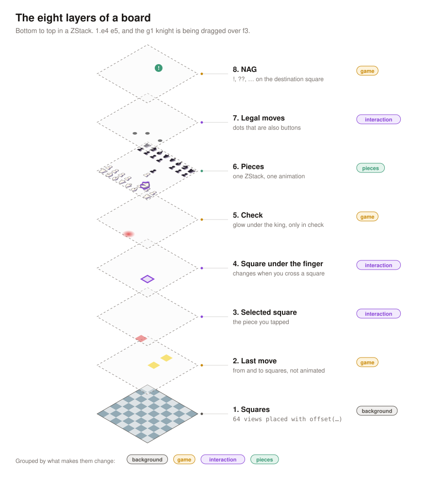
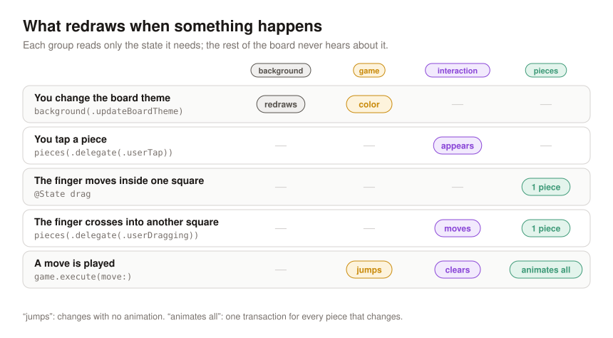
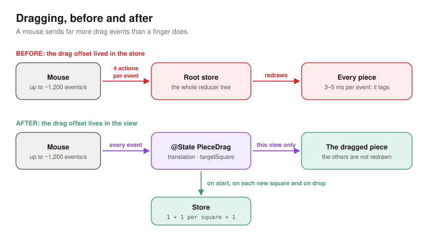
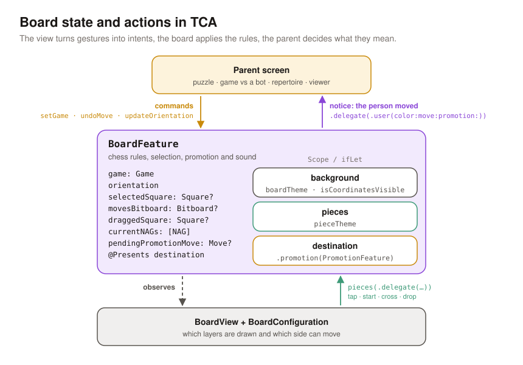

In the [previous article](../1766836145577-swift-chess-01/) we stored a chess board in memory with bitboards. This one covers the other half: **drawing it on screen** with SwiftUI, in a way that holds up to everything a chess app throws at it.

The board shows up almost everywhere in MindChess: puzzles, repertoire, the game viewer, the opening explorer, the GIF creator… Every one of those screens uses **the same board view**, and each wants something different. One lets only one side move, another lets nobody move, another animates more slowly so you can follow the reply. One view can cover all of that thanks to three decisions:

1. **Layers stacked in a `ZStack`**, all placed with the same geometry function.
2. **Layers grouped by what makes them change**, so a move, a tap or a drag only redraws what it has to.
3. **A TCA `State` and `Action` built around the gesture**: the view reports what the person did, the board applies the rules, and the parent screen decides what it means.

The code here is a rewritten, trimmed-down version of what the app uses. Both complete files are linked at the end.

## One geometry function

Before any layers, one rule: **everything drawn on the board is placed with the same function**. Squares, pieces, highlights, legal-move dots, arrows. If each layer did its own math, sooner or later one would drift by half a pixel, especially once you flip the board.

```swift
extension Square {
    func center(squareSize: CGFloat, orientation: Orientation) -> CGPoint {
        let column = orientation == .white ? file : 7 - file
        let row = orientation == .white ? 7 - rank : rank
        return CGPoint(x: (CGFloat(column) + 0.5) * squareSize,
                       y: (CGFloat(row) + 0.5) * squareSize)
    }
}
```

With Black at the bottom, column and row are flipped, and that's it. No layer knows the board is upside down. The inverse function, point to square, is what the drag gesture uses to find the square under your finger.

Every layer places its views with `.position(square.center(…))`. `position` puts the view's **center** at that point, which is exactly what the function returns. On the outside, `.aspectRatio(1, contentMode: .fit)` plus `min(width, height) / 8` keep the board square and let it fit any space: iPhone, iPad, Mac, or half the screen of a foldable.

## The eight layers

The board is a `ZStack` of eight layers. Bottom to top:



1. **Squares.** All 64, each at its `center`.
2. **Last move.** From and to squares highlighted.
3. **Selected square.** The piece you just tapped.
4. **Square under the finger.** While dragging, the square you would drop on.
5. **Check.** A red glow under the king, only when in check.
6. **Pieces.**
7. **Legal moves.** A dot on every square the selected piece can reach.
8. **NAG.** The `!`, `?`, `??`… badge of the move, on its destination square.

In the view, each layer is one line of the `ZStack`:

```swift
ZStack {
    BackgroundLayer(store: store.scope(state: \.background, action: \.background), …) // 1
    lastMove(squareSize: squareSize)                                                // 2
        .animation(nil, value: store.game)
    selection(squareSize: squareSize)                                               // 3 and 4
    check(squareSize: squareSize)                                                   // 5
    PiecesLayer(store: store.scope(state: \.pieces, action: \.pieces), …)           // 6
        .allowsHitTesting(configuration.movableSides.contains(store.game.turn))
    legalMoves(squareSize: squareSize)                                              // 7
    nag(squareSize: squareSize)                                                     // 8
}
.frame(width: side, height: side)
```

The order matters. Highlights sit **below** the pieces because they color the square, not the piece. Legal-move dots sit **above** because they are buttons as well as dots: if you capture by tapping the dot on top of an enemy piece, the tap has to reach the dot, not the piece. The NAG badge goes on top of everything so nothing ever covers it.

Each layer can also be switched on or off by a board configuration. A puzzle doesn't need NAGs; the game viewer doesn't need legal-move dots. Adding something new, like engine arrows, means slotting a layer in the right place without touching the others.

## Why some layers belong together

Eight layers doesn't mean eight independent things. Look at **what makes each layer change** and you get four groups. That grouping is what decides how things animate and how much gets redrawn:

- **Background** (layer 1): only changes with the board theme or the coordinates.
- **Game** (layers 2, 5 and 8): change when a move is played.
- **Interaction** (layers 3, 4 and 7): change at the pace of the gesture.
- **Pieces** (layer 6): change with the move, and are the only thing that animates.



### The background has its own store

The 64 squares live in a child view with its own scope of the store, and that view **only reads the theme**:

```swift
struct BackgroundLayer: View {
    let store: StoreOf<BackgroundFeature>
    let orientation: Orientation
    let squareSize: CGFloat

    var body: some View {
        SquaresLayer(theme: store.theme, orientation: orientation, squareSize: squareSize)
    }
}
```

With `@ObservableState`, SwiftUI re-evaluates a view's `body` only when something that view read has changed. The board as a whole changes on every move, every tap and every square your finger crosses, but the background never read any of that, so its 64 views are left alone. It only hears about a theme change in Settings.

### Pieces: one group, one animation

The pieces are a `ForEach` inside **their own `ZStack`**, with **a single** animation modifier:

```swift
ZStack {
    ForEach(pieces) { piece in
        let isDragged = piece.square == drag?.square
        PieceView(piece: piece, …, dragTranslation: isDragged ? drag?.translation : nil)
            .zIndex(isDragged ? 1 : 0)
            .onTapGesture { store.send(.delegate(.userTap(on: piece.square))) }
            .gesture(dragGesture(from: piece.square))
    }
}
.animation(.snappy(duration: animationDuration), value: pieces)
```

Grouping them like this buys three things:

1. **A move is one transaction.** Castling moves the king and the rook; a capture slides one piece and removes another. Because every piece hangs off the same `.animation(value: pieces)`, all of it happens in one animation, with one curve and one duration. No piece arrives before the others.
2. **`zIndex` works.** `zIndex` only orders siblings within the same container. Since all the pieces are siblings, the one you drag rises above the rest. If each piece lived in a different layer, there would be no way to lift it.
3. **The animation stays contained.** The modifier sits on the pieces group, not on the whole board, so nothing else animates by accident. The duration comes from the configuration: repertoire boards animate more slowly so the opponent's reply is easy to follow.

For SwiftUI to slide a piece instead of tearing it down and building a new one, each piece needs a **stable identity**: the g1 knight is still the same knight after it jumps to f3. In MindChess the engine keeps an identifier per piece, moves it along with the piece on every move, and restores it on undo. If the `id` were the square, every move would read as "a view disappears from g1 and another appears on f3", and there would be nothing to animate.

### The last move jumps, it doesn't slide

The last-move highlights depend on the game just like the pieces do. If the parent screen changes the game inside a `withAnimation` (stepping through the game viewer, say), those two yellow squares would slide from the previous move to the new one, trailing behind the pieces. It looks wrong. So that layer gets:

```swift
lastMove(squareSize: squareSize)
    .animation(nil, value: store.game)
```

Now the highlights are simply in place while the piece slides. The NAG badge gets the same result with a different tool: an `.id(…)` that changes with every move, so SwiftUI treats it as a new view instead of moving it from the previous square.

### Pieces that don't move aren't redrawn

Each piece is a small view that only takes values:

```swift
struct PieceView: View, Equatable {
    let piece: BoardPiece
    let style: PieceStyle
    let position: CGPoint
    let squareSize: CGFloat
    let dragTranslation: CGSize?
    …
}
```

While you drag, only one piece's `dragTranslation` changes. The other 31 get exactly the same values as before, and SwiftUI skips their `body`. This went from nice-to-have to essential because of dragging.

## Dragging, or what a mouse taught me

The first version kept the drag offset in the TCA store. Every `DragGesture` event sent actions with the new offset, and on iPhone it felt fine.

Then I tried it on the Mac with a mouse, and the piece trailed behind the pointer. I measured it: a mouse can send up to about **1,200 events per second** (a trackpad, about 150). Each event sent **four actions** through the reducer tree from the root and redrew every piece, at **3–5 ms per event**. The main thread couldn't keep up.



The fix was to separate **where the finger is** from **what the person means**. The offset lives in a `@State` of the pieces view; the store only hears what it cares about:

```swift
struct PieceDrag: Equatable {
    let square: Square
    var translation: CGSize = .zero
    var targetSquare: Square?

    /// Follows the finger and returns an action only when the square underneath changes.
    mutating func move(translation: CGSize, over target: Square?) -> PiecesFeature.Action.Delegate? {
        self.translation = translation
        guard let target, target != targetSquare else { return nil }
        targetSquare = target
        return .userDragging(on: target)
    }
}
```

Now dragging from g1 to f3 is a handful of actions: one on start, one per square crossed, one on drop. Every other event only touches the `@State`, which only redraws the moving piece.

One last detail: on drop, the piece is already sitting on its target square. If the game change were animated, SwiftUI would snap it back to the origin and slide it again. So the end of the gesture turns animations off for that transaction:

```swift
var transaction = Transaction()
transaction.disablesAnimations = true
withTransaction(transaction) {
    drag = nil
    if let target { store.send(.delegate(.userEndDragging(on: target))) }
}
```

### A reader's note

After the post went out, a reader left this reply on X:



Spot on, and it's exactly the split the change above was after. The offset lives in the view's `@State`, but dropping a piece (`userEndDragging`) and tapping a legal-move dot (`legalTargetTapped`) both end in the same `play` function, the only place a move reaches the game, and always after `isLegal`. When the board supports keyboard and VoiceOver, those inputs will have to send the same actions; that's a topic for another post.

The canceled drag is the part I didn't tell. In MindChess, if you release the piece outside the board, the selection clears and the game and its history stay the same. But the post didn't explain it, and the simplified sample code had left it out: with `target` set to `nil` nothing was sent, so `selectedSquare` and `draggedSquare` stayed set and the highlight stuck on screen. This is how the app handles it, and now the sample does too: the gesture reports the cancel and the board clears the selection.

```swift {hl_lines=[3]}
// PiecesFeature.Action.Delegate
case userEndDragging(on: Square)
case userCancelDragging
```

```swift {hl_lines=["4-5"]}
// DragGesture.onEnded
if let target {
    store.send(.delegate(.userEndDragging(on: target)))
} else {
    store.send(.delegate(.userCancelDragging))
}
```

```swift
// BoardFeature
case .pieces(.delegate(.userCancelDragging)):
    state.clearSelection()
    return .none
```

Thanks for reading it so carefully: that's how these posts get better.

## Board State and Action in TCA

With the layers settled: what goes in the store, and what doesn't? My rule is: **`State` holds what decides what gets drawn; the view holds what only describes how the gesture looks**.



### State

```swift
@ObservableState
struct State: Equatable {
    var game = Game.initial
    var orientation: Orientation = .white
    var background = BackgroundFeature.State()   // theme and coordinates
    var pieces = PiecesFeature.State()           // piece style
    var selectedSquare: Square?
    var legalTargets: Set<Square> = []
    var draggedSquare: Square?
}
```

- `game` is the source of truth: pieces, last move, check and side to move all come from it.
- `selectedSquare`, `legalTargets` and `draggedSquare` feed the interaction layers. In the app, legal moves are a bitboard (like the ones in the previous article), turned into squares when drawn.
- `background` and `pieces` are the state of two child features. Splitting them out is what lets the background observe only the theme.
- The app keeps two more things for promotion: the pending move and a `@Presents var destination` for the piece picker sheet. Plus the NAGs of the current move, which layer 8 draws.

Just as important is **what isn't** in `State`:

- **The drag offset**, for the reasons above.
- **The board configuration**: which layers are drawn, which sides can move, how long the animation takes. That's a per-screen decision, not state that changes, so it lives in the view:

```swift
struct BoardConfiguration: Equatable, Sendable {
    var movableSides: Set<PieceColor>
    var pieceAnimationDuration: Double
    var showsLastMove: Bool
    var showsSelection: Bool
    var showsLegalMoves: Bool
}

BoardView(store: store, configuration: .viewer)
```

The app has ready-made configurations for each screen: puzzle, PGN viewer, learning and practicing a repertoire… Repertoire practice, for instance, animates in 0.55 s instead of 0.18 s.

### Action

The board's actions read best grouped by **who sends them**:

```swift
enum Action: Sendable {
    // Commands from the parent screen
    case setGame(Game)
    case setOrientation(Orientation)
    // Child features
    case background(BackgroundFeature.Action)
    case pieces(PiecesFeature.Action)
    // From this view
    case legalTargetTapped(Square)
    // To the parent screen
    case delegate(Delegate)

    @CasePathable
    enum Delegate: Sendable {
        case userMoved(Move)
    }
}
```

The pieces feature never moves anything. It only reports what happened, through delegate actions: `userTap`, `userStartDragging`, `userDragging` (once per square) and `userEndDragging`. The board decides:

```swift
case let .pieces(.delegate(.userTap(on: square))),
     let .pieces(.delegate(.userStartDragging(on: square))):
    state.select(square)
    return .none

case let .pieces(.delegate(.userDragging(on: square))):
    state.draggedSquare = square
    return .none

case let .pieces(.delegate(.userEndDragging(on: square))),
     let .legalTargetTapped(square):
    return play(&state, to: square)
```

And `play` is the only place where a move becomes part of the game:

```swift
private func play(_ state: inout State, to square: Square) -> Effect<Action> {
    defer { state.clearSelection() }
    guard let from = state.selectedSquare else { return .none }
    let move = Move(from: from, to: square)
    guard state.game.isLegal(move) else { return .none }
    state.game.execute(move)
    return .send(.delegate(.userMoved(move)))
}
```

If the move isn't legal, the game doesn't change and the piece goes back to its square by itself, because its position always comes from `game`. In the app, this same spot also plays the move sound (a dependency) and, when a pawn reaches the last rank, presents the promotion sheet instead of executing the move.

### Why a delegate for the parent

The parent screen could observe `game` and react when it changes. But `game` changes for many reasons: a `setGame` on load, the engine's reply, an undo… The `userMoved` delegate says something more specific: **the person made this move**. With that, each screen does its own thing and the board knows nothing about it:

```swift
case let .board(.delegate(.userMoved(move))):
    // Puzzle: is this the move we were looking for?
    // Game against the engine: time to reply.
    // Repertoire: is it in your line?
```

The board has no idea whether it's in a puzzle or the viewer. It only knows chess and gestures.

## What I'd do differently

- **Think in groups from day one.** The layers arrived one by one, and the grouping (what animates, what jumps, what each view observes) came later, when something broke. It's easier to decide as you add each layer.
- **Keep anything continuous out of the store.** The drag in the store worked on iPhone and broke on the Mac. The rule now is simple: if it changes 60+ times a second and isn't a decision, it goes in `@State`.
- **Fold the selection into one value.** `selectedSquare` and the legal moves always travel together; a single optional `selection: (square, targets)?` would rule out half-set states.
- **Measure before optimizing.** 64 views for the squares are fine on an interactive board. For thumbnails in a game list I use `Canvas`, which draws without one view per square, but only because I measured it.

## The full code

- [`Board.swift`](code/Board.swift): model, geometry and layers in plain SwiftUI, no dependencies.
- [`BoardFeature.swift`](code/BoardFeature.swift): the TCA features (background, pieces and board), the layered view and the drag in `@State`, with an Xcode preview.

The rules are a toy (you can move to any square without one of your own pieces) so the example stays about drawing. Real legal moves, promotion and `TestStore` tests come in the next articles of the series.

If you want to see the board in action, it's in [MindChess](https://mindchess.app/), in every puzzle and every game you open.
