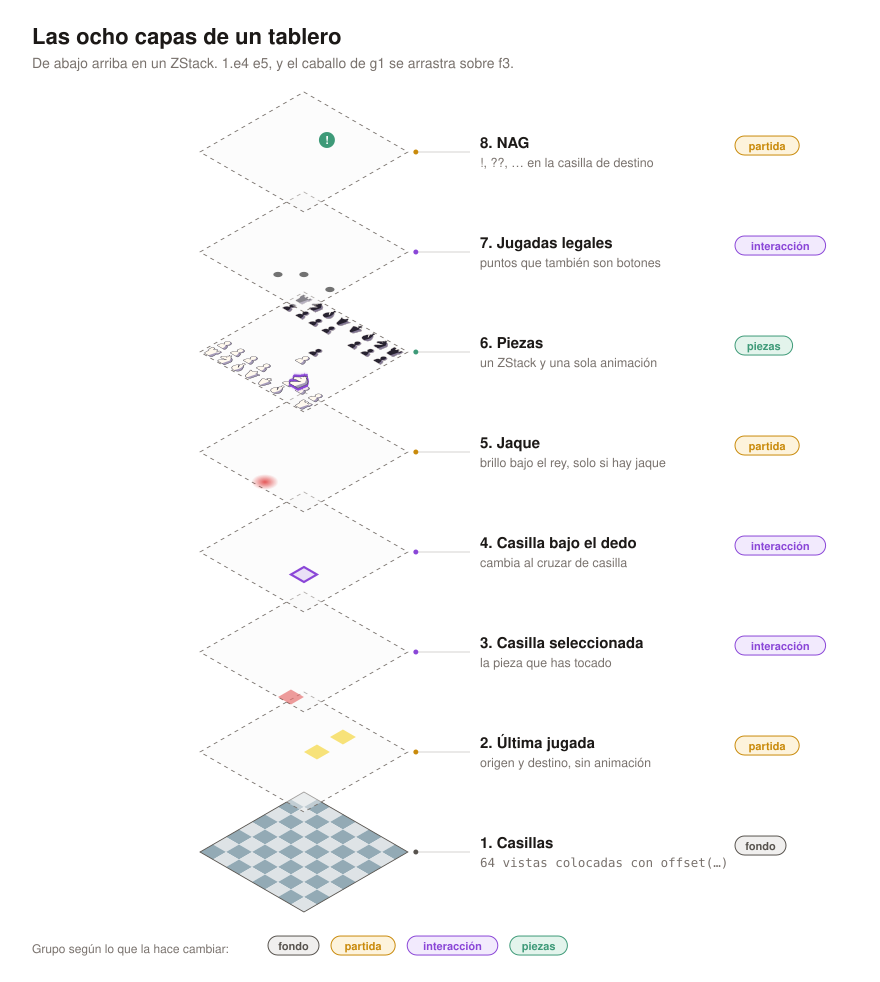
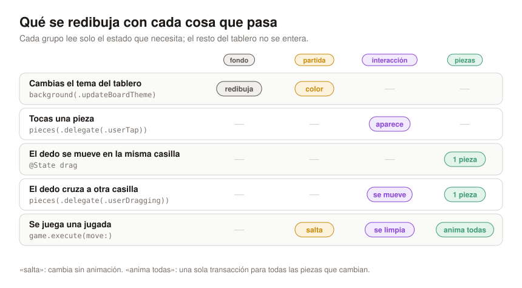
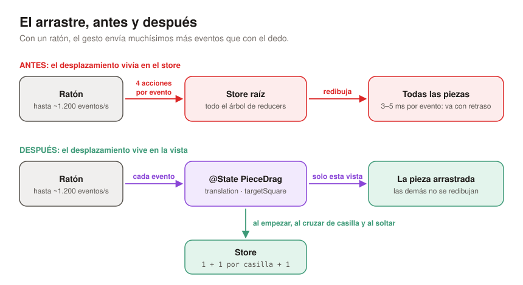
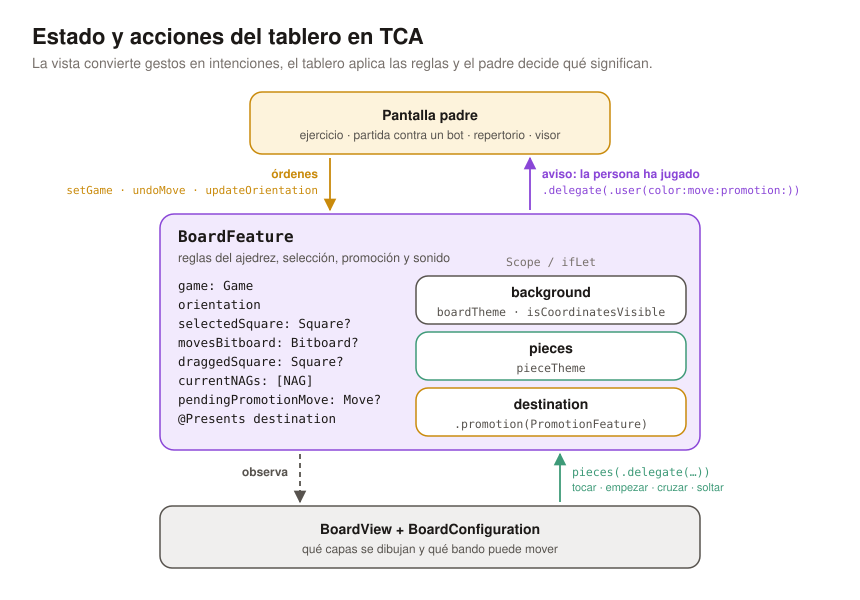

En el [artículo anterior](../1766836145577-swift-chess-01/) vimos cómo representar el tablero en memoria con bitboards. Hoy toca la otra mitad: **pintarlo en pantalla** con SwiftUI, y hacerlo de forma que aguante todo lo que le pide una app de ajedrez.

En MindChess el tablero aparece casi en todas partes: ejercicios, repertorio, visor de partidas, explorador de aperturas, el creador de GIF… Todas esas pantallas usan **el mismo tablero**, y cada una quiere algo distinto: una solo deja mover a un bando, otra no deja mover nada, otra anima más despacio para que se vea la respuesta. Que una sola vista sirva para todo eso depende de tres decisiones:

1. **Capas apiladas en un `ZStack`**, todas colocadas con la misma función de geometría.
2. **Capas agrupadas según lo que las hace cambiar**, para que una jugada, un toque o un arrastre solo redibujen lo que les toca.
3. **Un `State` y unas `Action` de TCA pensados para el gesto**: la vista cuenta lo que ha hecho la persona, el tablero aplica las reglas y la pantalla padre decide qué significa.

El código de este artículo es una versión reescrita y reducida de la de la app. Los dos archivos completos están al final.

## Una sola función de geometría

Antes de hablar de capas hace falta una regla: **todo lo que se dibuja sobre el tablero se coloca con la misma función**. Casillas, piezas, resaltados, puntos de jugadas legales, flechas… Si cada capa hiciera su propia cuenta, tarde o temprano una se desalinearía medio píxel, sobre todo al girar el tablero.

```swift
extension Square {
    func center(squareSize: CGFloat, orientation: Orientation) -> CGPoint {
        let column = orientation == .white ? file : 7 - file
        let row = orientation == .white ? 7 - rank : rank
        return CGPoint(x: (CGFloat(column) + 0.5) * squareSize,
                       y: (CGFloat(row) + 0.5) * squareSize)
    }
}
```

Con las negras abajo se invierten la columna y la fila, y nada más: ninguna capa sabe que el tablero está girado. La función inversa, de punto a casilla, es la que usa el arrastre para saber sobre qué casilla está el dedo.

Cada capa coloca sus vistas con `.position(square.center(…))`. `position` pone el **centro** de la vista en ese punto, que es justo lo que devuelve la función. Por fuera, `.aspectRatio(1, contentMode: .fit)` y `min(width, height) / 8` garantizan que el tablero sea cuadrado y quepa en cualquier hueco: iPhone, iPad, Mac o media pantalla de un plegable.

## Las ocho capas

El tablero es un `ZStack` de ocho capas. De abajo arriba:



1. **Casillas.** Las 64, cada una en su `center`.
2. **Última jugada.** Origen y destino resaltados.
3. **Casilla seleccionada.** La pieza que acabas de tocar.
4. **Casilla bajo el dedo.** Mientras arrastras, la casilla en la que soltarías.
5. **Jaque.** Un brillo rojo bajo el rey, solo cuando hay jaque.
6. **Piezas.**
7. **Jugadas legales.** Un punto en cada destino posible de la pieza seleccionada.
8. **NAG.** La insignia `!`, `?`, `??`… de la jugada en la casilla de destino.

En la vista, cada capa es una línea del `ZStack`:

```swift
ZStack {
    BackgroundLayer(store: store.scope(state: \.background, action: \.background), …) // 1
    lastMove(squareSize: squareSize)                                                // 2
        .animation(nil, value: store.game)
    selection(squareSize: squareSize)                                               // 3 y 4
    check(squareSize: squareSize)                                                   // 5
    PiecesLayer(store: store.scope(state: \.pieces, action: \.pieces), …)           // 6
        .allowsHitTesting(configuration.movableSides.contains(store.game.turn))
    legalMoves(squareSize: squareSize)                                              // 7
    nag(squareSize: squareSize)                                                     // 8
}
.frame(width: side, height: side)
```

El orden no es casual. Los resaltados van **debajo** de las piezas porque colorean la casilla, no la pieza. Los puntos de jugadas legales van **encima** porque, además de verse, son botones: si quieres capturar tocando el punto que hay sobre una pieza rival, el toque tiene que llegar al punto y no a la pieza. Y la insignia NAG va arriba del todo para que nunca la tape nada.

Cada capa, además, se puede encender o apagar desde una configuración del tablero. Un ejercicio no necesita NAG; el visor de partidas no necesita puntos de jugadas legales. Añadir algo nuevo, como las flechas del motor, consiste en meter una capa en su sitio sin tocar las demás.

## Por qué algunas capas van juntas

Ocho capas no significa ocho cosas independientes. Si te fijas en **qué hace cambiar cada capa**, salen cuatro grupos, y esa agrupación es la que decide cómo se anima y cuánto se redibuja:

- **Fondo** (capa 1): solo cambia con el tema del tablero o las coordenadas.
- **Partida** (capas 2, 5 y 8): cambian cuando se juega una jugada.
- **Interacción** (capas 3, 4 y 7): cambian al ritmo del gesto.
- **Piezas** (capa 6): cambian con la jugada, y son lo único que se anima.



### El fondo tiene su propio store

Las 64 casillas viven en una vista hija con su propio *scope* del store, y esa vista **solo lee el tema**:

```swift
struct BackgroundLayer: View {
    let store: StoreOf<BackgroundFeature>
    let orientation: Orientation
    let squareSize: CGFloat

    var body: some View {
        SquaresLayer(theme: store.theme, orientation: orientation, squareSize: squareSize)
    }
}
```

Con `@ObservableState`, SwiftUI vuelve a evaluar el `body` de una vista solo cuando cambia algo que esa vista ha leído. El tablero entero cambia con cada jugada, cada toque y cada casilla que cruza el dedo, pero el fondo no ha leído nada de eso, así que sus 64 vistas no se vuelven a calcular. Solo se entera cuando cambias el tema en Ajustes.

### Las piezas, en un solo grupo y con una sola animación

Las piezas son un `ForEach` dentro de **su propio `ZStack`**, con **un único** modificador de animación:

```swift
ZStack {
    ForEach(pieces) { piece in
        let isDragged = piece.square == drag?.square
        PieceView(piece: piece, …, dragTranslation: isDragged ? drag?.translation : nil)
            .zIndex(isDragged ? 1 : 0)
            .onTapGesture { store.send(.delegate(.userTap(on: piece.square))) }
            .gesture(dragGesture(from: piece.square))
    }
}
.animation(.snappy(duration: animationDuration), value: pieces)
```

Agruparlas así tiene tres ventajas:

1. **Una jugada es una sola transacción.** En un enroque se mueven el rey y la torre; en una captura, una pieza se desliza y otra desaparece. Como todas las piezas cuelgan de la misma `.animation(value: pieces)`, todo eso ocurre en la misma animación, con la misma curva y la misma duración. No hay piezas que lleguen antes que otras.
2. **El `zIndex` funciona.** `zIndex` solo ordena entre hermanos del mismo contenedor. Como todas las piezas son hermanas, la que arrastras sube por encima de las demás. Si cada pieza estuviera en una capa distinta, no habría forma de levantarla.
3. **La animación no se escapa.** El modificador está en el grupo de piezas, no en todo el tablero, así que nada más se anima por accidente. La duración llega desde la configuración: los tableros de repertorio animan más despacio para que se vea bien la respuesta del rival.

Para que SwiftUI deslice una pieza en vez de destruirla y crearla otra vez, cada pieza necesita una **identidad estable**: el caballo de g1 sigue siendo el mismo caballo cuando salta a f3. En MindChess el motor guarda un identificador por pieza y lo mueve con ella en cada jugada (y lo restaura al deshacer). Si el `id` fuera la casilla, cada jugada sería «desaparece una vista en g1 y aparece otra en f3», y no habría nada que animar.

### La última jugada salta, no se desliza

Los resaltados de la última jugada dependen de la partida igual que las piezas. Si la pantalla padre cambia la partida dentro de un `withAnimation` (por ejemplo, al avanzar en el visor), esos dos rectángulos amarillos se deslizarían de la jugada anterior a la nueva, por detrás de las piezas, y queda raro. Por eso esa capa lleva:

```swift
lastMove(squareSize: squareSize)
    .animation(nil, value: store.game)
```

Con eso, los resaltados aparecen ya en su sitio mientras la pieza se desliza. La insignia NAG va por el mismo camino con otra herramienta: lleva un `.id(…)` que cambia con cada jugada, así que SwiftUI la trata como una vista nueva en lugar de moverla desde la casilla anterior.

### Las piezas que no se mueven no se redibujan

Cada pieza es una vista pequeña que solo recibe valores:

```swift
struct PieceView: View, Equatable {
    let piece: BoardPiece
    let style: PieceStyle
    let position: CGPoint
    let squareSize: CGFloat
    let dragTranslation: CGSize?
    …
}
```

Mientras arrastras, solo cambia `dragTranslation` de una pieza. Las otras 31 reciben exactamente los mismos valores que antes, y SwiftUI se salta su `body`. Esto pasó de detalle a necesidad por culpa del arrastre.

## El arrastre, o lo que aprendí con un ratón

La primera versión guardaba el desplazamiento del arrastre en el store de TCA. Cada evento del `DragGesture` enviaba acciones con el nuevo `offset`, y en el iPhone funcionaba bien.

Al probarlo en el Mac con ratón, la pieza iba por detrás del puntero. Lo medí: un ratón puede mandar hasta unos **1.200 eventos por segundo** (un trackpad, unos 150). Cada evento enviaba **cuatro acciones** que recorrían el árbol de reducers desde la raíz y redibujaban todas las piezas, entre **3 y 5 ms por evento**. El hilo principal no daba abasto.



La solución fue separar lo que es **posición del dedo** de lo que es **intención**. El desplazamiento vive en un `@State` de la vista de piezas; el store solo se entera de lo que le importa:

```swift
struct PieceDrag: Equatable {
    let square: Square
    var translation: CGSize = .zero
    var targetSquare: Square?

    /// Sigue al dedo y devuelve una acción solo cuando cambia la casilla de debajo.
    mutating func move(translation: CGSize, over target: Square?) -> PiecesFeature.Action.Delegate? {
        self.translation = translation
        guard let target, target != targetSquare else { return nil }
        targetSquare = target
        return .userDragging(on: target)
    }
}
```

Con esto, un arrastre de g1 a f3 son unas pocas acciones: una al empezar, una por cada casilla que cruzas y una al soltar. El resto de eventos solo cambian el `@State`, que solo redibuja la pieza que se mueve.

Un último detalle: al soltar, la pieza ya está visualmente en su casilla de destino. Si el cambio de partida se animara, SwiftUI la llevaría de vuelta al origen y la volvería a deslizar. Por eso el final del gesto desactiva las animaciones de esa transacción:

```swift
var transaction = Transaction()
transaction.disablesAnimations = true
withTransaction(transaction) {
    drag = nil
    if let target { store.send(.delegate(.userEndDragging(on: target))) }
}
```

### Lo que me señaló un lector

Al publicar el artículo, un lector me dejó este comentario en X:



Traducido al español:


Guarda la posición del puntero en local, pero manda la jugada terminada por la misma comprobación de legalidad que el toque, el teclado y VoiceOver. Un arrastre cancelado no debe cambiar ni el tablero ni el historial. Si no, el ratón acaba siendo un segundo motor de reglas.


Tiene toda la razón, y es justo la separación que buscaba el cambio de arriba. El desplazamiento vive en el `@State` de la vista, pero soltar una pieza (`userEndDragging`) y tocar el punto de una jugada legal (`legalTargetTapped`) acaban en la misma función, `play`, que es el único sitio donde una jugada llega a la partida y siempre después de `isLegal`. Cuando el tablero sea accesible con teclado y VoiceOver, esas entradas tendrán que mandar las mismas acciones; eso da para otro artículo.

Donde sí acertó de lleno fue en el arrastre cancelado. Si soltabas la pieza fuera del tablero, `target` era `nil` y no se mandaba nada. La partida no cambiaba, pero `selectedSquare` y `draggedSquare` se quedaban puestos y el resaltado seguía en pantalla. Ahora el gesto también avisa cuando se cancela, y el tablero limpia la selección:

```swift {hl_lines=[3]}
// PiecesFeature.Action.Delegate
case userEndDragging(on: Square)
case userCancelDragging
```

```swift {hl_lines=["4-5"]}
// DragGesture.onEnded
if let target {
    store.send(.delegate(.userEndDragging(on: target)))
} else {
    store.send(.delegate(.userCancelDragging))
}
```

```swift
// BoardFeature
case .pieces(.delegate(.userCancelDragging)):
    state.clearSelection()
    return .none
```

Gracias por leerlo con tanto cuidado: así es como estos artículos mejoran.

## El State y las Action del tablero en TCA

Con las capas claras, ¿qué guarda el store y qué no? La regla que sigo es: **en el `State` va lo que decide qué se dibuja; en la vista, lo que solo dice cómo se ve el gesto**.



### State

```swift
@ObservableState
struct State: Equatable {
    var game = Game.initial
    var orientation: Orientation = .white
    var background = BackgroundFeature.State()   // tema y coordenadas
    var pieces = PiecesFeature.State()           // estilo de las piezas
    var selectedSquare: Square?
    var legalTargets: Set<Square> = []
    var draggedSquare: Square?
}
```

- `game` es la fuente de la verdad: de ella salen las piezas, la última jugada, el jaque y el turno.
- `selectedSquare`, `legalTargets` y `draggedSquare` alimentan las capas de interacción. En la app, las jugadas legales son un bitboard (como los del artículo anterior), que se convierte en casillas al dibujar.
- `background` y `pieces` son el estado de dos features hijas. Separarlas es lo que permite que el fondo solo observe el tema.
- La app guarda dos cosas más para la promoción: la jugada pendiente y un `@Presents var destination` con la hoja para elegir pieza. Y las NAG de la jugada actual, que dibuja la capa 8.

Igual de importante es **lo que no está** en el `State`:

- **El desplazamiento del arrastre**, por lo que acabamos de ver.
- **La configuración del tablero**: qué capas se dibujan, qué bandos pueden mover y cuánto dura la animación. Eso es una decisión de cada pantalla, no estado que cambie, así que va en la vista:

```swift
struct BoardConfiguration: Equatable, Sendable {
    var movableSides: Set<PieceColor>
    var pieceAnimationDuration: Double
    var showsLastMove: Bool
    var showsSelection: Bool
    var showsLegalMoves: Bool
}

BoardView(store: store, configuration: .viewer)
```

En la app hay configuraciones ya hechas para cada pantalla: ejercicio, visor de PGN, aprender y practicar repertorio… La de practicar repertorio, por ejemplo, anima en 0,55 s en lugar de 0,18 s.

### Action

Las acciones del tablero se leen mejor agrupadas por **quién las envía**:

```swift
enum Action: Sendable {
    // Órdenes de la pantalla padre
    case setGame(Game)
    case setOrientation(Orientation)
    // Features hijas
    case background(BackgroundFeature.Action)
    case pieces(PiecesFeature.Action)
    // De esta vista
    case legalTargetTapped(Square)
    // Para la pantalla padre
    case delegate(Delegate)

    @CasePathable
    enum Delegate: Sendable {
        case userMoved(Move)
    }
}
```

La feature de piezas no mueve nada. Solo cuenta lo que ha pasado con delegados: `userTap`, `userStartDragging`, `userDragging` (una vez por casilla) y `userEndDragging`. Es el tablero quien decide:

```swift
case let .pieces(.delegate(.userTap(on: square))),
     let .pieces(.delegate(.userStartDragging(on: square))):
    state.select(square)
    return .none

case let .pieces(.delegate(.userDragging(on: square))):
    state.draggedSquare = square
    return .none

case let .pieces(.delegate(.userEndDragging(on: square))),
     let .legalTargetTapped(square):
    return play(&state, to: square)
```

Y `play` es el único sitio donde una jugada se convierte en partida:

```swift
private func play(_ state: inout State, to square: Square) -> Effect<Action> {
    defer { state.clearSelection() }
    guard let from = state.selectedSquare else { return .none }
    let move = Move(from: from, to: square)
    guard state.game.isLegal(move) else { return .none }
    state.game.execute(move)
    return .send(.delegate(.userMoved(move)))
}
```

Si la jugada no es legal, la partida no cambia y la pieza vuelve sola a su casilla, porque su posición siempre sale de `game`. En la app, ese mismo punto también lanza el sonido de la jugada (una dependencia) y, si un peón llega a la última fila, presenta la hoja de promoción en lugar de ejecutar.

### Por qué un delegado para el padre

La pantalla padre podría observar `game` y reaccionar cuando cambie. Pero `game` cambia por muchos motivos: un `setGame` al cargar, la respuesta del motor, deshacer… El delegado `userMoved` dice algo más concreto: **esta jugada la ha hecho la persona**. Con eso, cada pantalla hace lo suyo sin que el tablero sepa nada de ella:

```swift
case let .board(.delegate(.userMoved(move))):
    // Ejercicio: ¿es la jugada que buscábamos?
    // Partida contra el motor: toca responder.
    // Repertorio: ¿está en tu línea?
```

El tablero no sabe si está en un ejercicio o en el visor. Solo sabe ajedrez y gestos.

## Qué haría distinto

- **Pensaría en grupos desde el principio.** Las capas salieron una a una, y la agrupación (qué se anima, qué salta, qué observa cada vista) llegó después, cuando algo iba mal. Es más fácil decidirlo al añadir cada capa.
- **No pondría nada continuo en el store.** El arrastre en el store funcionaba en el iPhone y falló en el Mac. Ahora la regla es sencilla: si cambia a 60 o más veces por segundo y no es una decisión, va en `@State`.
- **Juntaría la selección en un solo valor.** `selectedSquare` y las jugadas legales siempre van juntas; un `selection: (square, targets)?` opcional evitaría estados a medias.
- **Mediría antes de optimizar.** 64 vistas para las casillas van bien en un tablero interactivo. Para las miniaturas de una lista de partidas uso `Canvas`, que dibuja sin crear una vista por casilla, pero solo porque lo medí.

## El código completo

- [`Board.swift`](code/Board.swift): modelo, geometría y capas en SwiftUI, sin dependencias.
- [`BoardFeature.swift`](code/BoardFeature.swift): las features de TCA (fondo, piezas y tablero), la vista con sus capas y el arrastre en `@State`, con una vista previa para Xcode.

Las reglas son de juguete (puedes mover a cualquier casilla que no tenga una pieza tuya) para que el ejemplo se centre en el dibujo. Las jugadas legales de verdad, la promoción y los tests con `TestStore` llegan en los próximos artículos de la serie.

Si quieres ver el tablero en acción, está en [MindChess](https://mindchess.app/), en cada ejercicio y en cada partida que abras.
