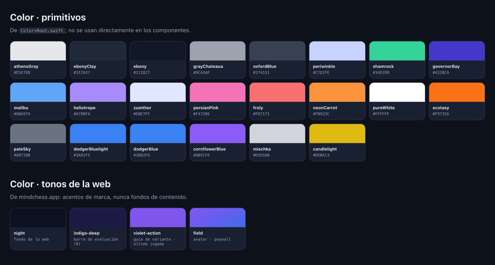
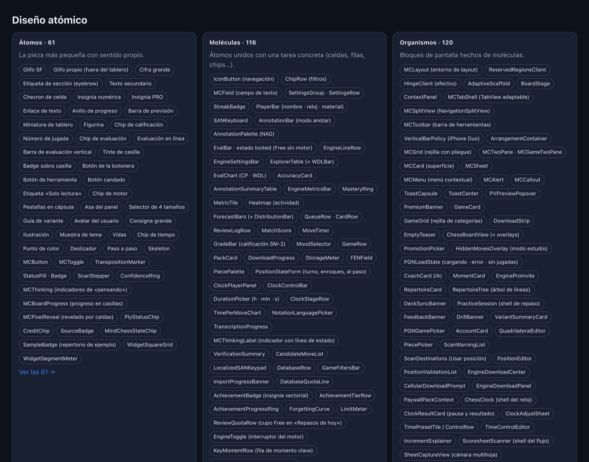
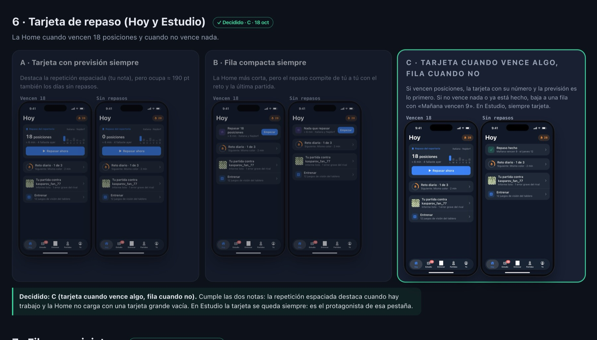
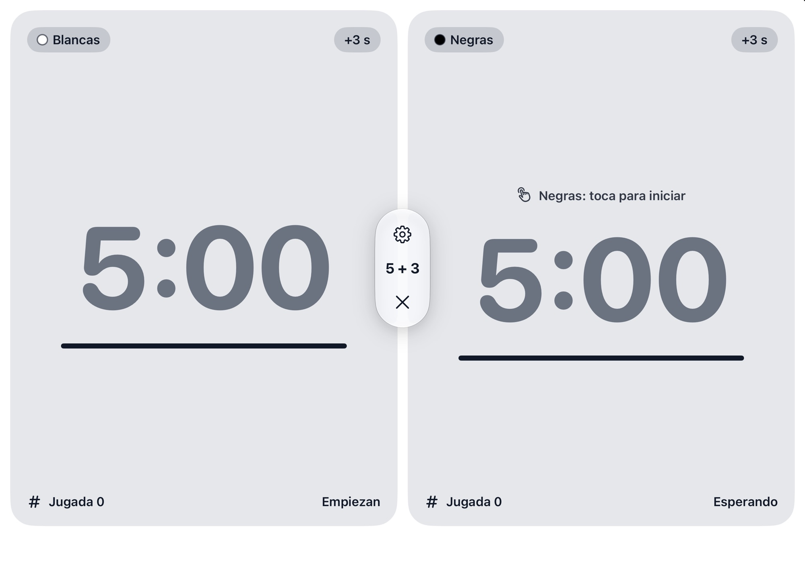
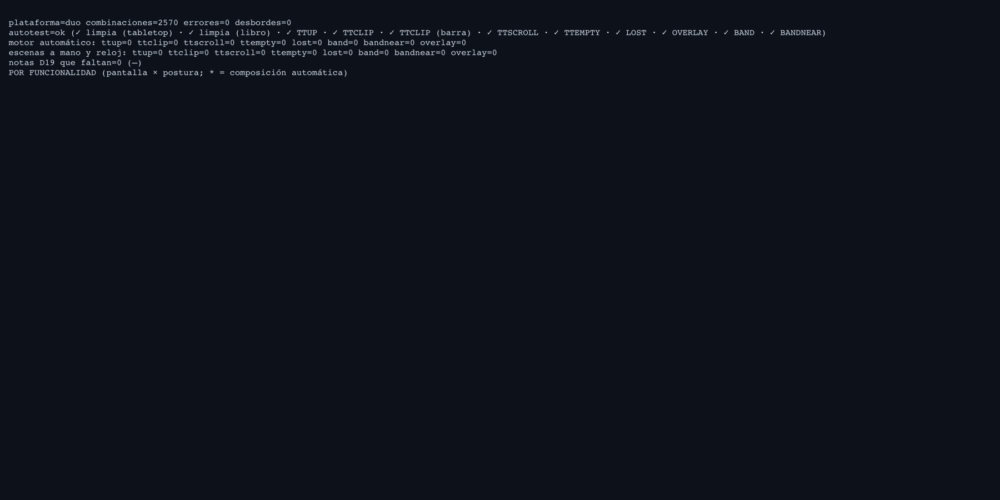
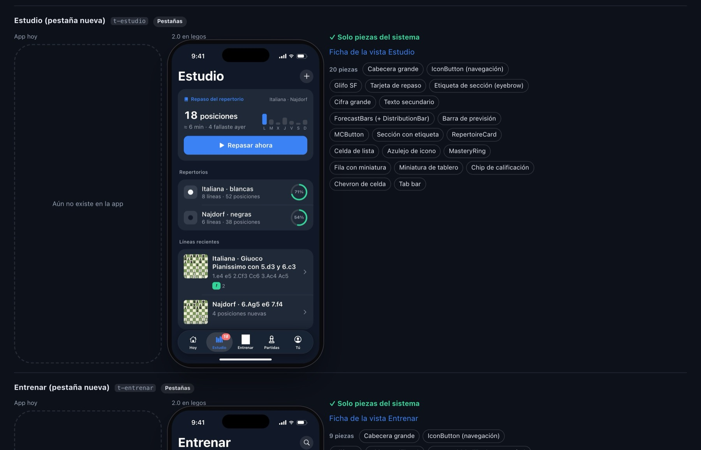

<!-- Draft 2026-11-04 on branch drafts/kit-y-animaciones. English version of index.es.md. Figures checked against the kit (CCoach-minchess-migration) on 4 Nov; images taken from the kit and the app, whose UI is in Spanish. -->

MindChess is a chess app for iPhone, iPad, the iPhone Duo and Mac, and I build it on my own. With that many screen sizes, the risk isn't that coding takes too long. The risk is ending up with a different app on every device, because each screen was decided in a hurry on the day it had to be written.

What has worked for me is to **design first, in HTML, with AI agents**, and not touch SwiftUI until the screen exists in a kit that shares its numbers with the app. In this post I explain how that kit is put together, how a kit screen becomes a SwiftUI view, and what I do when the code and the design disagree.

The kit and the app are in Spanish, so the screenshots below are too. I describe each one in the text.

## Why HTML and not Figma

I can't draw well, and AI agents don't draw either: **they write code**. An HTML kit has three advantages for someone in my position:

1. **An agent writes it and reviews it.** I ask for "the Today screen with the daily challenge on top and the reviews below" and I get back a function. I can read it, fix it and ask for variants.
2. **It can be checked with code.** If every screen is a function, I can render it at twenty sizes and look for overflows with a script. In a design file you check that by eye.
3. **It speaks the same language as SwiftUI.** Both are declarative descriptions: "a column with a title, a card and a list". Going from one to the other is translation, not reinterpreting a drawing.

## One source of truth: the tokens

Everything starts in the Swift Styleguide. The app's primitive colours live in a file with names that carry no meaning, just the colour:

```swift
extension Color {
    static let ebony = hex(0x111827)
    static let ebonyClay = hex(0x1F2937)
    static let athensGray = hex(0xE5E7EB)
    static let dodgerBlue = hex(0x3B82F6)
    public static let shamrock = hex(0x34D399)
    public static let neonCarrot = hex(0xFB923C)
    // …
}
```

On top of them sit the semantic tokens, which are the ones the views use: background, surface, text, secondary text. Each one picks its value from the colour scheme:

```swift
public var backgroundPrimary: Color {
    colorScheme == .dark ? .ebony : .white
}
```

The kit **copies those primitives one by one** into CSS variables with the same names (`--ebony`, `--dodgerBlue`…) and defines the semantic tokens exactly like the app. Spacing is the same grid on both sides:

```swift
extension CGFloat {
    public static func grid(_ n: Int) -> Self { Self(n) * 4 }
}
```

```css
.kit { --g: 4px; }           /* grid(n) = 4n */
.a-btn { height: calc(var(--g) * 11); border-radius: calc(var(--g) * 3); }
```

In the kit, the tokens page shows those same primitives with their Swift names, and the semantic tokens in light and dark:



When the kit says "padding of `grid(3)`", in SwiftUI I write `.padding(.grid(3))` and get exactly the same thing. Kit and app share numbers, so there is nothing to measure.

## Atoms, molecules, organisms and views

The kit follows atomic design to the letter. Version 2.0 of the system has **327 spec sheets** across four levels:

- **Atoms (61):** the smallest piece that means something on its own. A glyph, a big number, a status pill, a board thumbnail.
- **Molecules (116):** atoms put together for one job. A review row is thumbnail + title + subtitle + pill.
- **Organisms (120):** screen blocks made of molecules, such as the review card, the chess clock or the Duo's two-pane container.
- **Views (30):** organisms with real data, which is already a screen.



The demo below is a very small version of the kit, built on the same idea (with simpler names: cells and compositions instead of molecules and organisms). Step through the levels, switch between light and dark, and try the screen on the iPhone and in the iPhone Duo's two folded postures:



## Every screen is a function

Nothing in the kit is drawn by hand. Every screen is an object with an id, a title and a `render` function, built from shared helpers for the bar, the board, cards and rows:

```js
const screens = {
  today: {
    id: "today", title: "Hoy",   // "Today"
    render(layout) {
      return page(
        title("Hoy"),
        K.challenge(),   // daily challenge card
        K.review(),      // "Today's reviews" section
        K.week()         // this week's tiles
      );
    }
  }
};
```

Because the colour scheme is a parameter, every screen comes out in light and dark with no extra work. Before I wrote the Swift for version 1.3, the kit already had **156 screens** in both schemes. Today the iPhone kit alone has 279.

The important part is that an AI agent writes these functions. My job is to say what has to happen on the screen, review what comes out, and decide.

## Choosing between variants, not starting from a blank page

Important screens don't get one proposal, they get several. The kit has a numbered **decisions** section, and each decision shows the variants side by side: A, B, C, D. I pick one, and that decision stays written in the kit with its number.

You can see it later in the code. MindChess commits cite the decision they implement (the screen names are the Spanish ones: Hoy is Today, Partidas is Games, Tú is You, Ajustes is Settings):

```text
Hoy C, Partidas D, and Tú and Ajustes B (kit Decisiones › 9–11)
Reto B, Reloj B, GIF D and Novedades A (kit Decisiones › 12–16)
```

This is what one of those decisions looks like in the kit: the review card on Today, with three variants, each shown with reviews due and with nothing due. C won:



Months later, when I come back to a screen, the kit tells me what was discarded and why.

## Spec sheets, not drawings

A design system component isn't a picture, it's a **spec sheet**. Each one has:

1. **What it's for:** when to use it, when not to, and the exact screens that use it.
2. **Anatomy and tokens.** The chess clock, for example, uses the accent colour while it runs, orange below 60 s, red below 10 s, and its own colour when the flag falls.
3. **Variants, states and a state machine.** The clock goes through *setup → ready → running → paused → flagged → finished*. 118 components have a state machine you can simulate in the kit.
4. **The SwiftUI side:** properties, events and, for 47 components, the TCA contract (view, internal and delegate actions).
5. **Accessibility, HIG notes and the tests it has to pass.**

The spec sheets are generated as pages of the kit itself, so documentation and views never drift apart.

## Every iPhone Duo posture, composed and checked on its own

An iPhone screen doesn't work as-is on an open Duo: the hinge splits the screen in half. The kit composes every screen for the iPad and for each Duo posture with three rules:

- **Nothing tappable on the hinge** or within 8 pt of it.
- **Tabletop:** visuals in the raised half, everything you touch in the base.
- **Sheets and menus stay in their half.**

Try it in the demo with "Duo book" and "Duo tabletop": the same `render` function receives the geometry and places the compositions on each side.

And this is how it looks in the real app. With the Duo open flat, the chess clock puts one player in each half and the controls in a capsule between them. In book posture, with the screen folded, that capsule moves away from the hinge:



And since it's all code, it is also checked with code. A script runs through **156 screens × 20 layouts = 3,120 combinations** and looks for overflows, clipped content, controls next to the hinge or empty halves in tabletop. Before 1.3 it came out with 0 errors. Today the Duo alone has 2,570 combinations, and the QA page is still at zero:



## From the kit to SwiftUI

Once the screen is decided, moving to SwiftUI is almost mechanical, because everything that matters already has a name:

- **Constants have the same names.** The air around the hinge is `P.DUO.AIR` in the kit and `MCFoldMetrics.air` in Swift, with a comment pointing back to the original:

  ```swift
  /// Fixed iPhone Duo distances of the kit (`P.DUO`).
  public enum MCFoldMetrics {
      /// Minimum distance between anything tappable and the hinge band (`P.DUO.AIR`).
      public static let air: CGFloat = 8
      /// Height of the tabletop base bar (`P.DUO.BASEBAR`).
      public static let baseBarHeight: CGFloat = 76
  }
  ```

- **Rules are cited by number.** The Duo layout starts with a comment saying it implements decision D28, and which kit file holds the geometry.
- **Some tables are compared by tests.** The Mac menu bar comes from a command table that mirrors the kit's, and a test checks that the identifiers, the order and the shortcuts match.
- **Snapshots are compared with the kit.** Every screen has snapshots on the iPhone and in each Duo posture, and they are reviewed next to the kit screen.

The kit also checks the other direction: that a new screen can be built **only from system pieces**. The "Screens" page puts each capture of the app next to its 2.0 version built from spec sheets, and flags anything visible that isn't inside a piece as a gap:



I use agents for the implementation too. I give them the kit screen, the spec sheets of the components it uses and the decision number, and the result is much closer to what I want than if I ask them to "make me a Today screen".

## When the code drifts from the kit

It happens. Sometimes a kit screen can't take a long German string, or an animation needs room nobody planned for. The rule is simple: **if the code drifts, the kit gets updated**. Design and code never drift apart silently.

The kit also keeps real captures of the published app, so the design and the real screen can be seen side by side.

## What I take away

- **An HTML kit is a kit an agent can write, read and check.** For a solo developer that matters more than drawing nicely.
- **Sharing numbers removes the translation step.** If the kit and SwiftUI use the same tokens and the same grid, going from one to the other is copying.
- **Choosing between variants is faster than inventing.** And it leaves a record of why each thing was chosen.
- **Whatever can be checked with code gets checked with code:** screens, postures, command tables and snapshots.

In the [next post](../1793810125084-animaciones-onboarding-html-swiftui/) I go one level down: how the onboarding animations go from an HTML canvas to a SwiftUI `Canvas` with the same function.


