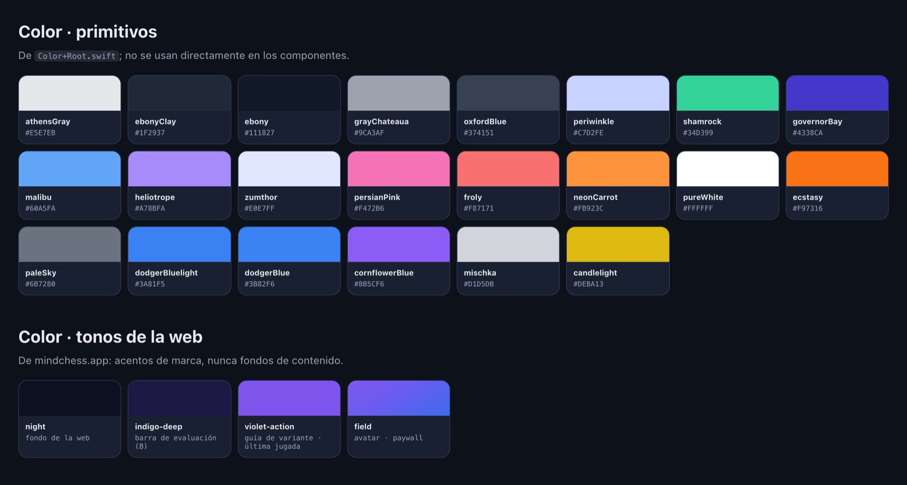
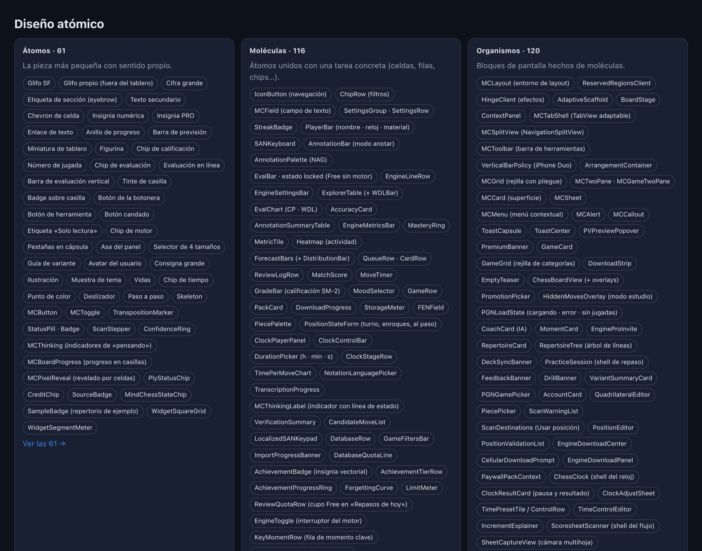
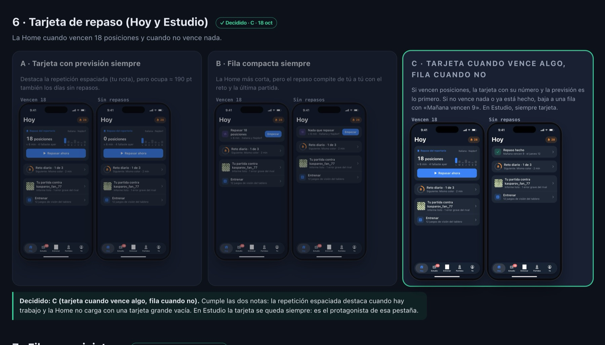
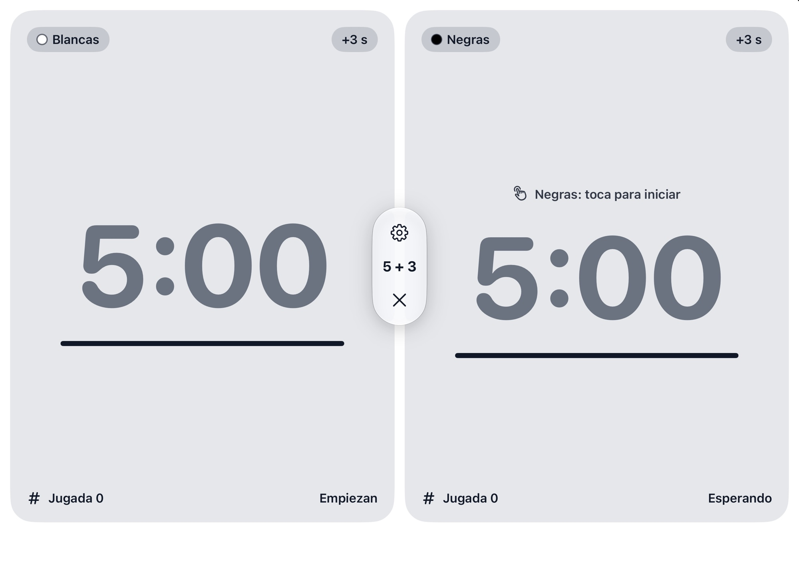
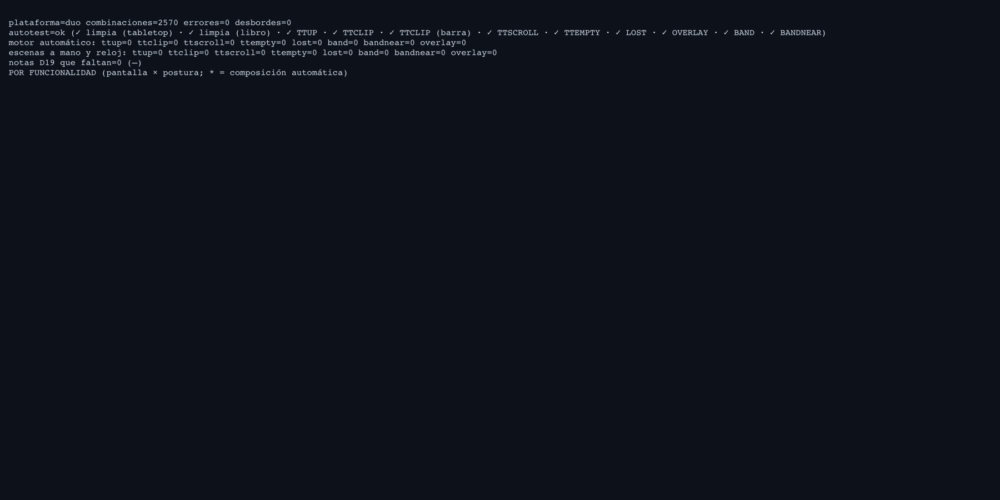
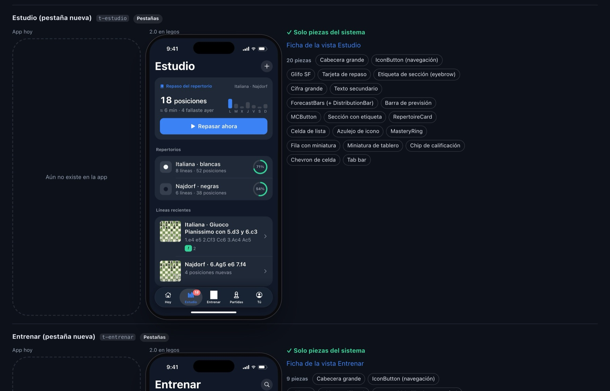

<!-- Borrador 2026-11-04 en la rama drafts/kit-y-animaciones. Cifras revisadas con el kit (CCoach-minchess-migration) el 4 nov; capturas sacadas del kit y de la app. -->

MindChess es una app de ajedrez para iPhone, iPad, el iPhone Duo y Mac, y la hago yo solo. Con tantos tamaños de pantalla, el riesgo no es tardar en programar: es acabar con una app distinta en cada dispositivo, porque cada pantalla se decidió con prisa el día que tocaba escribirla.

La solución que me ha funcionado es **diseñar primero, en HTML, con agentes de IA**, y no tocar SwiftUI hasta que la pantalla existe en un kit que comparte los números con la app. En este artículo cuento cómo está montado ese kit, cómo se pasa de una pantalla del kit a una vista de SwiftUI y qué hago cuando el código y el diseño no coinciden.

## Por qué HTML y no Figma

No sé dibujar bien, y los agentes de IA tampoco dibujan: **escriben código**. Un kit en HTML tiene tres ventajas para alguien en mi situación:

1. **Un agente lo escribe y lo revisa.** Le pido «la pantalla de Hoy con el reto diario arriba y los repasos debajo» y me devuelve una función. Puedo leerla, corregirla y pedirle variantes.
2. **Se puede comprobar con código.** Si cada pantalla es una función, puedo pintarla en veinte tamaños y buscar desbordes con un script. En un archivo de diseño eso se revisa a ojo.
3. **Habla el mismo idioma que SwiftUI.** Las dos son descripciones declarativas: «una columna con un título, una tarjeta y una lista». Pasar de una a otra es traducir, no reinterpretar un dibujo.

## Una sola fuente de verdad: los tokens

Todo empieza en el Styleguide de Swift. Los colores primitivos de la app viven en un archivo con nombres sin significado, solo el color:

```swift
extension Color {
    static let ebony = hex(0x111827)
    static let ebonyClay = hex(0x1F2937)
    static let athensGray = hex(0xE5E7EB)
    static let dodgerBlue = hex(0x3B82F6)
    public static let shamrock = hex(0x34D399)
    public static let neonCarrot = hex(0xFB923C)
    // …
}
```

Encima van los tokens semánticos, que son los que usan las vistas: fondo, superficie, texto, texto secundario. Cada uno decide su valor según el esquema de color:

```swift
public var backgroundPrimary: Color {
    colorScheme == .dark ? .ebony : .white
}
```

El kit **copia esos primitivos uno a uno** a variables CSS con el mismo nombre (`--ebony`, `--dodgerBlue`…), y define los semánticos igual que la app. El espaciado es la misma rejilla en los dos lados:

```swift
extension CGFloat {
    public static func grid(_ n: Int) -> Self { Self(n) * 4 }
}
```

```css
.kit { --g: 4px; }           /* grid(n) = 4n */
.a-btn { height: calc(var(--g) * 11); border-radius: calc(var(--g) * 3); }
```

En el kit, la página de tokens enseña esos mismos primitivos con su nombre de Swift y los semánticos en claro y oscuro:



Cuando el kit dice «padding de `grid(3)`», en SwiftUI escribo `.padding(.grid(3))` y sale exactamente lo mismo. Kit y app comparten números, así que no hay que medir nada.

## Átomos, moléculas, organismos y vistas

El kit sigue *atomic design* al pie de la letra. En la versión 2.0 del sistema hay **327 fichas** repartidas en cuatro niveles:

- **Átomos (61):** la pieza más pequeña con sentido propio. Un glifo, una cifra grande, una píldora de estado, una miniatura de tablero.
- **Moléculas (116):** átomos unidos con una tarea concreta. Una fila de repaso es miniatura + título + subtítulo + píldora.
- **Organismos (120):** bloques de pantalla hechos de moléculas, como la tarjeta de repaso, el reloj o el contenedor de dos paneles del Duo.
- **Vistas (30):** organismos con datos de verdad, que ya son una pantalla.



La demo de abajo es una versión muy reducida del kit, hecha con la misma idea (con nombres más sencillos: celdas y composiciones en vez de moléculas y organismos). Recorre los niveles, cambia entre claro y oscuro y prueba la pantalla en el iPhone y en las dos posturas plegadas del iPhone Duo:



## Cada pantalla es una función

En el kit nada se dibuja a mano. Cada pantalla es un objeto con un identificador, un título y una función `render`, y se construye con unos helpers compartidos para la barra, el tablero, las tarjetas o las filas:

```js
const screens = {
  today: {
    id: "today", title: "Hoy",
    render(layout) {
      return page(
        title("Hoy"),
        K.challenge(),   // tarjeta del reto diario
        K.review(),      // sección «Repasos de hoy»
        K.week()         // mosaicos de la semana
      );
    }
  }
};
```

Como el esquema de color es un parámetro, cada pantalla sale en claro y en oscuro sin hacer nada más. Antes de escribir el Swift de la versión 1.3 ya había **156 pantallas** en el kit, en los dos esquemas. Hoy, solo el kit de iPhone tiene 279.

Lo importante es que estas funciones las escribe un agente de IA. Mi trabajo es decir qué tiene que pasar en la pantalla, revisar lo que sale y decidir.

## Decidir entre variantes, no a partir de una hoja en blanco

Las pantallas importantes no tienen una propuesta, tienen varias. El kit tiene una sección de **decisiones** numeradas, y en cada una se ven las variantes una al lado de otra: A, B, C, D. Yo elijo una y esa decisión queda escrita en el kit con su número.

Eso se nota luego en el código. Los commits de MindChess citan la decisión que implementan:

```text
Hoy C, Partidas D, and Tú and Ajustes B (kit Decisiones › 9–11)
Reto B, Reloj B, GIF D and Novedades A (kit Decisiones › 12–16)
```

Así es una de esas decisiones en el kit: la tarjeta de repaso de Hoy, con tres variantes en claro y en oscuro, con repasos pendientes y sin ellos. Ganó la C:



Meses después, cuando vuelvo a una pantalla, el kit me dice qué se descartó y por qué.

## Fichas de componente, no dibujos

Un componente del sistema de diseño no es una imagen, es una **ficha**. Cada una tiene:

1. **Para qué sirve:** cuándo usarlo, cuándo no y las pantallas exactas que lo usan.
2. **Anatomía y tokens.** El reloj de ajedrez, por ejemplo, usa el acento mientras corre, naranja por debajo de 60 s, rojo por debajo de 10 s y su propio color cuando cae la bandera.
3. **Variantes, estados y máquina de estados.** El reloj pasa por *setup → ready → running → paused → flagged → finished*. 118 componentes tienen su máquina de estados simulable en el kit.
4. **La parte de SwiftUI:** propiedades, eventos y, en 47 componentes, el contrato de TCA (acciones de vista, internas y delegadas).
5. **Accesibilidad, notas de la HIG y los tests que tiene que pasar.**

Las fichas se generan como páginas del propio kit, así que la documentación y las vistas nunca se separan.

## Cada postura del iPhone Duo, compuesta y revisada sola

Una pantalla de iPhone no sirve tal cual en el Duo abierto: la bisagra parte la pantalla por la mitad. El kit compone cada pantalla para el iPad y para cada postura del Duo con tres reglas:

- **Nada pulsable en la bisagra** ni a menos de 8 pt de ella.
- **Tabletop:** lo visual en la mitad levantada, todo lo que se toca en la base.
- **Hojas y menús, en su mitad.**

Pruébalo en la demo con «Duo libro» y «Duo tabletop»: la misma función `render` recibe la geometría y coloca las composiciones a cada lado.

Y así queda en la app de verdad. El reloj de ajedrez, con el Duo abierto en plano, pone un jugador en cada mitad y los controles en una cápsula entre las dos. En libro, con la pantalla doblada, esa cápsula se aparta de la bisagra:



Y como todo es código, también se revisa con código. Un script recorre **156 pantallas × 20 layouts = 3.120 combinaciones** y busca desbordes, contenido cortado, controles junto a la bisagra o mitades vacías en tabletop. Antes de la 1.3 salía con 0 errores. Hoy, solo para el Duo, son 2.570 combinaciones, y la página de QA sigue en cero:



## Del kit a SwiftUI

Con la pantalla decidida, el paso a SwiftUI es casi mecánico, porque todo lo que importa ya tiene nombre:

- **Las constantes se llaman igual.** El aire alrededor de la bisagra es `P.DUO.AIR` en el kit y `MCFoldMetrics.air` en Swift, con un comentario que apunta al original:

  ```swift
  /// Fixed iPhone Duo distances of the kit (`P.DUO`).
  public enum MCFoldMetrics {
      /// Minimum distance between anything tappable and the hinge band (`P.DUO.AIR`).
      public static let air: CGFloat = 8
      /// Height of the tabletop base bar (`P.DUO.BASEBAR`).
      public static let baseBarHeight: CGFloat = 76
  }
  ```

- **Las reglas se citan por su número.** El layout del Duo empieza con un comentario que dice que implementa la decisión D28, y en qué archivo del kit está la geometría.
- **Algunas tablas se comparan con tests.** La barra de menús del Mac sale de una tabla de comandos que es espejo de la del kit, y un test comprueba que los identificadores, el orden y los atajos coinciden.
- **Los snapshots se comparan con el kit.** Cada pantalla tiene snapshots en iPhone y en cada postura del Duo, y se revisan al lado de la pantalla del kit.

El kit también comprueba lo contrario: que una pantalla nueva se pueda montar **solo con piezas del sistema**. La página «Pantallas» pone cada captura de la app al lado de su versión 2.0 hecha con fichas, y marca como hueco cualquier cosa visible que no esté dentro de una pieza:



Para la implementación también uso agentes. Les paso la pantalla del kit, la ficha de los componentes que usa y el número de la decisión, y el resultado se parece mucho más a lo que quiero que si les pido «hazme una pantalla de Hoy».

## Cuando el código se aparta del kit

Pasa. A veces una pantalla del kit no aguanta un texto largo en alemán, o una animación pide un hueco que no estaba previsto. La regla es simple: **si el código se aparta, se actualiza el kit**. Diseño y código nunca se separan en silencio.

Además, el kit guarda capturas reales de la app publicada, así que el diseño y la pantalla de verdad se ven una al lado de la otra.

## Lo que me llevo

- **Un kit en HTML es un kit que un agente puede escribir, leer y comprobar.** Para un desarrollador solo, eso pesa más que dibujar bonito.
- **Compartir números elimina la traducción.** Si el kit y SwiftUI usan los mismos tokens y la misma rejilla, pasar de uno a otro es copiar.
- **Decidir entre variantes es más rápido que inventar.** Y deja escrito por qué se eligió cada cosa.
- **Lo que se puede comprobar con código, se comprueba con código:** pantallas, posturas, tablas de comandos y snapshots.

En el [siguiente artículo](../1793810125084-animaciones-onboarding-html-swiftui/) bajo un nivel: cómo las animaciones del onboarding pasan de un canvas en HTML a un `Canvas` de SwiftUI con la misma función.


