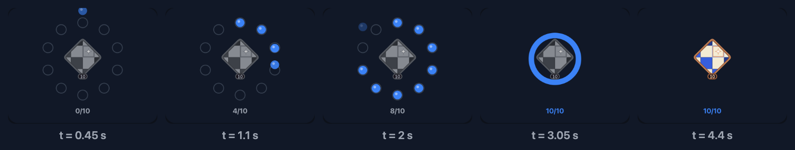
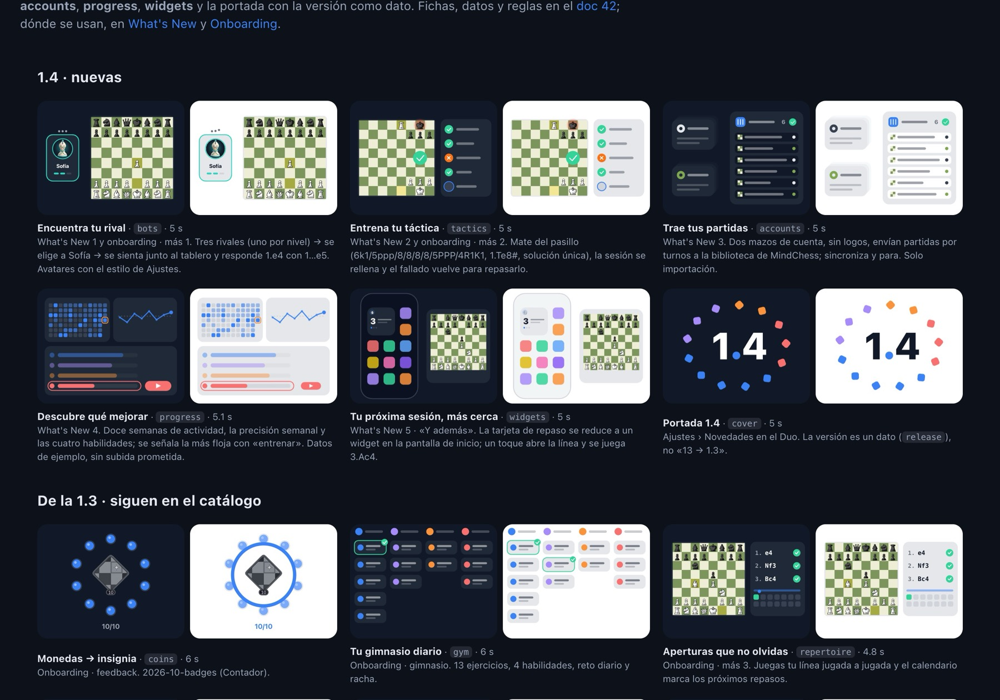

<!-- Draft 2026-11-04 on branch drafts/kit-y-animaciones. English version of index.es.md. Checked against design-iphone/assets/motion.js on 4 Nov; frames taken from the kit. To do: GIF or video of the scene in the app. -->

The MindChess onboarding and What's New screen have small animated scenes: ten coins that drop into a ring and melt into a badge, a paper board that straightens up and becomes the app's board, three opponents you pick from and one of them answers 1…e5.

They were all born in HTML, in the same design kit as the [previous post](../1793810125083-kit-html-a-swiftui/), and they all moved to SwiftUI **without a single SwiftUI animation**: no `withAnimation`, no `matchedGeometryEffect`, no transitions. This post walks through the process with one of them, the coins, which you can play with right here:



Drag `t` and you'll see you can jump to any instant, forwards or backwards. That's the whole idea.

## Step 1: a scene is a function of time

The usual way to animate in SwiftUI is to declare states and let the system interpolate between them. It works very well for UI, but for a five-second scene with fifteen things moving out of step it turns into a chain of `DispatchQueue.main.asyncAfter`, intermediate states and animations stepping on each other.

The MindChess scenes have no state. They have a function:

```text
draw(t) → the frame at second t
```

Everything on screen is computed from `t`: where each coin is, its opacity, the size of the badge, how many coins the counter shows. Nothing depends on the previous frame.

That gives you three things for free:

- **Deterministic snapshots:** drawing `draw(4.4)` always gives the same image.
- **Reduce Motion:** instead of animating, you draw a single still frame that already tells the story.
- **Seamless loops:** if everything is back at zero opacity at the end of the scene, second 0 and the last second match.

## Step 2: a fixed box and a grammar

Every scene is drawn in a logical box of **360 × 280** points and then scaled to whatever space the screen gives it. So the prototype's coordinates and the Swift coordinates are the same, number for number.

And every scene follows the same grammar: **entry → action → result → rest**. For the coins:

| Phase | Time | What happens |
|---|---|---|
| Entry | 0–0.25 s | The ring of ten slots appears |
| Action | 0.35–2.15 s | A coin drops every 0.2 s and the counter goes up |
| Result | 2.75–3.7 s | The ring melts, the badge flips and is earned, sparks fly |
| Rest | 4.4 s | The still frame: the badge and "10/10" |

The rest frame (`stillTime`) is the one drawn with Reduce Motion and in snapshots, so it has to tell the story on its own.

These are five frames of the kit's scene, drawn with `draw(t)` at five instants. The last one is the rest frame:



## Step 3: closed-form curves

For `draw(t)` to be pure, motion can't come from a step-by-step simulation. Every curve is a **closed-form formula** you can evaluate at any instant. There are four of them, and they fit on one screen.

In JavaScript, in the prototype:

```js
function spring(x, w = 14) {          // damped spring from 0 to 1
  if (x <= 0) return 0;
  const z = 0.78, wd = w * Math.sqrt(1 - z * z), e = Math.exp(-z * w * x);
  return 1 - e * (Math.cos(wd * x) + (z * w / wd) * Math.sin(wd * x));
}
const clamp = (v, a = 0, b = 1) => Math.min(b, Math.max(a, v));
function smooth(a, b, x) { const u = clamp((x - a) / (b - a)); return u * u * (3 - 2 * u); }
const lerp = (a, b, k) => a + (b - a) * k;
```

And in Swift, in the app, line by line:

```swift
public enum Motion {
    /// Damped spring from 0 to 1 starting at `x = 0` (damping 0.78, `w` rad/s); 0 before it starts.
    public static func spring(_ x: Double, _ w: Double = 14) -> Double {
        guard x > 0 else { return 0 }
        let z = 0.78, wd = w * (1 - z * z).squareRoot(), e = exp(-z * w * x)
        return 1 - e * (cos(wd * x) + (z * w / wd) * sin(wd * x))
    }

    public static func clamp(_ v: Double, _ a: Double = 0, _ b: Double = 1) -> Double { min(b, max(a, v)) }

    public static func smooth(_ a: Double, _ b: Double, _ x: Double) -> Double {
        let u = clamp((x - a) / (b - a))
        return u * u * (3 - 2 * u)
    }

    public static func lerp(_ a: Double, _ b: Double, _ k: Double) -> Double { a + (b - a) * k }

    /// A spring up at `c` and back down `len` seconds later.
    public static func bump(_ t: Double, _ c: Double, _ len: Double = 0.14, _ w: Double = 30) -> Double {
        spring(t - c, w) - spring(t - c - len, w)
    }
}
```

`spring` is the response of a spring with 0.78 damping: it rises from 0 to 1, overshoots a little and settles. The `w` parameter decides how fast. `smooth` is a smoothstep between two instants, perfect for fades. `bump` is a spring that goes up and comes back down: the "pop" of the badge when it is earned.

In the demo above you can change the damping and the frequency and see how the coins' drop changes.

## Step 4: prototyping in the browser with AI

The prototype lives in the design kit, in a JavaScript scenes file (`motion.js`). Today it has fourteen scenes, and the kit page shows all of them at once, in dark and light, with their duration and where each one is used:



Each scene is a function that receives a `<canvas>` context and `t`. Writing them with an AI agent works especially well, for three reasons:

1. **The plain-language description is almost the code already.** "Ten coins on a ring of radius 88; one drops every 0.2 s from 64 pt higher with a spring of frequency 16" translates almost literally.
2. **You iterate by looking at the browser.** I reload, drag time to the moment I don't like, and tell the agent what to change at that exact second.
3. **The data is real.** Colours come from the kit's tokens and, in the scenes with a board, from real positions and moves, with the same look as the app.

This is the coin scene in the prototype (trimmed):

```js
function draw(ctx, t) {
  const cx = 180, cy = 124, r = 88, forge = 2.75;
  ctx.globalAlpha = smooth(0, 0.25, t) * (1 - smooth(5.4, 5.9, t)); // fade in and out
  const melt = smooth(forge, forge + 0.3, t);
  for (let i = 0; i < 10; i++) {
    const a = -Math.PI / 2 + i * 2 * Math.PI / 10;
    const p = { x: cx + r * Math.cos(a), y: cy + r * Math.sin(a) };
    const ti = 0.35 + i * 0.2, k = spring(t - ti, 16);
    if (t <= ti) continue;
    const y = lerp(p.y - 64, p.y, k);            // drops from 64 pt higher
    coin(ctx, p.x, y, (t - ti) * 6 * (1 - melt)); // and melts when the badge is forged
  }
  // …the ring, the flipping badge, the sparks and the counter
}
```

## Step 5: porting to SwiftUI

With the scene decided, the port has three pieces.

**A protocol for scenes.** Each scene says how long it lasts, which frame is its still frame and how it is drawn:

```swift
public protocol MotionScene: Sendable {
    var duration: Double { get }
    var stillTime: Double { get }
    var box: CGSize { get }       // 360 × 280 by default
    var speed: Double { get }     // 1 by default
    func draw(_ canvas: inout MotionCanvas, t: Double)
}
```

**A canvas you copy.** `MotionCanvas` wraps SwiftUI's `GraphicsContext`, the colour scheme's palette and a few helpers (`circle`, `fill`, `line`, `text`). It is a value type, and that replaces the HTML canvas's `save()` and `restore()`: to change the opacity or the transform of one part, you copy it, change the copy and throw it away.

```swift
var coin = c                       // a copy: saves the state
coin.fade(M.clamp((t - ti) * 6) * (1 - melt))
coin.circle(CGPoint(x: p.x, y: y), 10.5, accent)
// when this scope ends, `c` is unchanged
```

**The scene, translated line by line.** With the same curves and the same box, the Swift scene reads like the JavaScript one:

```swift
struct CoinsScene: MotionScene {
    var duration: Double { 6 }
    var stillTime: Double { 4.4 }

    func draw(_ c: inout MotionCanvas, t: Double) {
        let cx = 180.0, cy = 124.0, r = 88.0, forge = 2.75
        c.fade(M.smooth(0, 0.25, t) * (1 - M.smooth(5.4, 5.9, t)))
        let melt = M.smooth(forge, forge + 0.3, t)
        for i in 0..<10 {
            let a = -Double.pi / 2 + Double(i) * 2 * .pi / 10
            let p = CGPoint(x: cx + r * cos(a), y: cy + r * sin(a))
            let ti = 0.35 + Double(i) * 0.2, k = M.spring(t - ti, 16)
            guard t > ti else { continue }
            var coin = c
            coin.fade(M.clamp((t - ti) * 6) * (1 - melt))
            let y = M.lerp(p.y - 64, p.y, k)
            coin.circle(CGPoint(x: p.x, y: y), 10.5, accent)
        }
        // …the ring, the flipping badge, the sparks and the counter
    }
}
```

## Step 6: playing it

What's left is the view that gives the scene its time. It is a `Canvas` inside a `TimelineView`, which scales the 360 × 280 box to the available space and calls `draw` with the right `t`:

```swift
TimelineView(.animation(minimumInterval: 1 / 60, paused: !isLive || !isOnScreen)) { timeline in
    Canvas { context, size in
        let time = reduceMotion || isResting
            ? scene.stillTime
            : liveTime(timeline.date.timeIntervalSince(start))
        draw(in: context, size: size, t: time)
    }
}
```

This is where the details you don't see in the prototype came up:

- **It plays twice and then stays still.** An endless loop in an onboarding is distracting and drains the battery. After two loops the scene stops at its `stillTime`, which falls inside the second loop, so there is no jump. From then on the `TimelineView` is paused and nothing is redrawn.
- **`speed`.** Some scenes were designed longer than suits the app. Instead of redoing the timings, the scene declares a speed and real time is multiplied by it. That way each scene loops in about five seconds.
- **Paused when off screen** and hidden from VoiceOver, because it's decorative: the text on the page already says the same thing.
- **With the user's look.** Scenes with a board use the board and piece themes the person picked in Settings.
- **With the device posture.** On the iPhone Duo, the clock scene shows the clock in real tabletop posture, with the hinge.

## Step 7: the tests

Since time is a parameter, an environment value lets you pin it:

```swift
public enum MotionPlayback: Equatable, Sendable {
    case live
    case still
    case time(Double)
}
```

The onboarding and What's New snapshots draw each scene at its still frame, in light and dark, on the iPhone and in each Duo posture. If someone changes a curve and the badge is no longer centred at second 4.4, the test fails.

## What I take away

- **A function of time is easier to reason about than a chain of animations.** And you can jump to any instant to debug it.
- **Closed-form formulas travel well between languages.** The JavaScript curves and the Swift curves are the same lines in a different syntax.
- **Prototyping in the browser with an agent is very fast** when you can point at a specific second and say what's wrong.
- **Accessibility and tests come for free** if the still frame tells the story.


