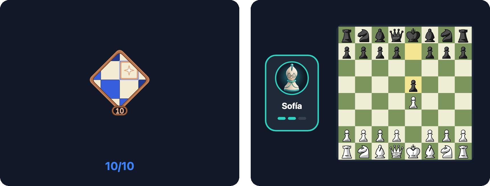
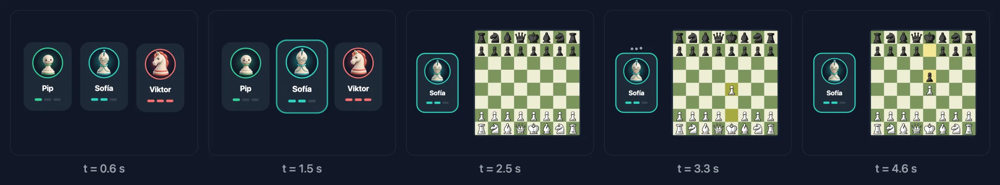

For a while now I've been watching people make motion graphics with AI. Since Opus 5.5 came out, every week someone shows up with a product video, an animated intro or an explainer full of moving type, all of it made by describing what they want to an agent that writes the code.

After watching a few of them, I started wondering about something else: **is there a way to do the same thing and take it to native SwiftUI?** I don't want a video inside the app. I want a scene that's drawn on the device, like any other view.

Because the scene is code and not an embedded video, I control things a video can't. I can change its speed without exporting anything again. The same scene is drawn in light or dark mode colours, because it reads the app's colours at that moment. And it can adapt to the device: on the iPhone Duo it makes no sense to show the same animation with the phone open and closed, and the clock scene, for example, shows the real hinge when the Duo is in tabletop mode. Here it is both ways:



There's another case I find even more interesting. Some people turn on **Reduce Motion** in Settings › Accessibility › Motion, because animations make them dizzy or distract them. Apps can read that setting (in SwiftUI, through the `accessibilityReduceMotion` environment value). With a video, all you can do is remove it. With a scene in code, I pick a frame that already tells the story and leave it as a still image, respecting that person's choice.

These are the scenes in the MindChess onboarding and What's New screen. They were born in HTML with an AI agent. Then they moved to SwiftUI **without a single SwiftUI animation**, no `withAnimation`, no `matchedGeometryEffect`, no transitions.



Let's talk about these two examples.

## The idea: a scene is a function of time

The usual way to animate in SwiftUI is to declare states and let the system interpolate between them. It works very well for UI, but for a five-second scene with fifteen things moving out of step it turns into a chain of `DispatchQueue.main.asyncAfter`, intermediate states and animations stepping on each other.

The motion graphics people make with AI don't work like that. They're a timeline. At 1200 ms this is here, and 300 ms later, at 1500 ms, it's over there. So I borrowed that idea. The MindChess scenes have no state. They have a function:

```text
draw(t) → the frame at second t
```

Everything on screen is computed from `t`: where each piece is, its opacity, its size, which move has been played. Nothing depends on the previous frame.

That gives you three things for free:

- **Deterministic snapshot tests** (tests that compare an image of the view with a saved one): drawing `draw(4.4)`, the 4400 ms mark, always gives the same image.
- **Reduce Motion:** instead of animating, you draw a single still frame that already tells the story.
- **Seamless loops:** if everything fades back to zero opacity at the end, the first frame and the last one line up.

And a fourth one, which is the one that matters here: **a pure function translates from one language to another.** If the prototype is a stateless JavaScript function, the Swift port is another function with the same lines.

## A fixed box and a grammar

Every scene is drawn in a logical box of **360 × 280** points and then scaled to whatever space the screen gives it. That way the prototype's coordinates and the Swift ones are the same, number for number.

And they all follow the same grammar: **entry → action → result → rest**. Something appears, something happens, you see the result and the scene settles on a frame that sums it up. That rest frame is the instant each scene declares as its `stillTime`. It's the one drawn with Reduce Motion and in the snapshot tests, so it has to tell the story on its own.

This grammar is also what I ask the agent for. I don't say "make me a nice animation". I tell it what happens in each phase and at which millisecond.

## Closed-form curves

For `draw(t)` to be pure, motion can't come from a step-by-step simulation. Every curve is a **closed-form formula** you can evaluate at any instant. There are five of them, and they fit on one screen.

In JavaScript, in the prototype:

```js
const S = (x, w = 14) => {          // damped spring from 0 to 1
  if (x <= 0) return 0;
  const z = 0.78, wd = w * Math.sqrt(1 - z * z), e = Math.exp(-z * w * x);
  return 1 - e * (Math.cos(wd * x) + ((z * w) / wd) * Math.sin(wd * x));
};
const clamp = (v, a = 0, b = 1) => Math.min(b, Math.max(a, v));
const smooth = (a, b, x) => { const u = clamp((x - a) / (b - a)); return u * u * (3 - 2 * u); };
const lerp = (a, b, k) => a + (b - a) * k;
const bump = (t, c, len = 0.14, w = 30) => S(t - c, w) - S(t - c - len, w);
```

And in Swift, in the app, line by line:

```swift
public enum Motion {
    /// Damped spring from 0 to 1 starting at `x = 0` (damping 0.78, `w` rad/s); 0 before it starts.
    public static func spring(_ x: Double, _ w: Double = 14) -> Double {
        guard x > 0 else { return 0 }
        let z = 0.78, wd = w * (1 - z * z).squareRoot(), e = exp(-z * w * x)
        return 1 - e * (cos(wd * x) + (z * w / wd) * sin(wd * x))
    }

    public static func clamp(_ v: Double, _ a: Double = 0, _ b: Double = 1) -> Double { min(b, max(a, v)) }

    public static func smooth(_ a: Double, _ b: Double, _ x: Double) -> Double {
        let u = clamp((x - a) / (b - a))
        return u * u * (3 - 2 * u)
    }

    public static func lerp(_ a: Double, _ b: Double, _ k: Double) -> Double { a + (b - a) * k }

    /// A spring up at `c` and back down `len` seconds later.
    public static func bump(_ t: Double, _ c: Double, _ len: Double = 0.14, _ w: Double = 30) -> Double {
        spring(t - c, w) - spring(t - c - len, w)
    }
}
```

`spring` is the response of a spring with 0.78 damping. It goes from 0 to 1, overshoots a little and settles. The `w` parameter sets how fast. `smooth` goes from 0 to 1 between two instants, easing in and out (graphics people call this curve *smoothstep*), perfect for fades. `bump` is a spring that goes up and comes back down, a "pop".

In the demos for both cases, further down, you can change the damping and the frequency and see how the shape of the spring changes. The dot marks where the scene's main spring is at each instant.

## Prototyping in the browser with AI

The prototype lives in the MindChess design kit, in a JavaScript file of scenes (`motion.js`). Each scene is a function that takes a `<canvas>` context and `t`. Writing them with an AI agent works especially well, for three reasons:

1. **The plain-language description is almost the code already.** "Ten coins on a ring of radius 88; one drops every 200 milliseconds from 64 pt above with a spring of frequency 16" translates almost literally.
2. **You iterate by looking at the browser.** I reload, drag time to the moment I don't like and tell the agent what to change at that exact instant.
3. **The data is real.** The colours come from the app's tokens, the pieces are the game's and the avatars are the real bots'.

Then the same agent does the port. I give it the JavaScript scene and the Swift kit, and since both are pure functions with the same curves, the result comes out right almost on the first try.

## The SwiftUI port

The port has three parts.

**A protocol for scenes.** Each scene says how long it lasts, which frame is its still frame and how it's drawn:

```swift
public protocol MotionScene: Sendable {
    var duration: Double { get }
    var stillTime: Double { get }
    var box: CGSize { get }       // 360 × 280 by default
    var speed: Double { get }     // 1 by default
    func draw(_ canvas: inout MotionCanvas, t: Double)
}
```

**A canvas you copy.** `MotionCanvas` wraps SwiftUI's `GraphicsContext` (the object you draw with inside a `Canvas`), the colour scheme's palette and a few helpers (`circle`, `fill`, `text`, `image`). It's a value type (a `struct`: assigning it makes a copy), and that replaces the HTML canvas's `save()` and `restore()`, which save and restore the drawing state. To change the opacity or the transform of one part, you copy it, change the copy and throw it away.

```swift
var coin = c                       // a copy: saves the state
coin.fade(M.clamp((t - ti) * 6) * (1 - melt))
coin.circle(CGPoint(x: p.x, y: y), 10.5, accent)
// when this scope ends, `c` is as it was
```

**A view that gives the scene its time.** It's a `Canvas` (SwiftUI's view for drawing by hand, like an HTML `<canvas>`) inside a `TimelineView` (a view that redraws on every frame and tells you the time). It scales the 360 × 280 box to the available space and calls `draw` with the right `t`:

```swift
TimelineView(.animation(minimumInterval: 1 / 60, paused: !isLive || !isOnScreen)) { timeline in
    Canvas { context, size in
        let time = reduceMotion || isResting
            ? scene.stillTime
            : liveTime(timeline.date.timeIntervalSince(start))
        draw(in: context, size: size, t: time)
    }
}
```

With that in place, let's go back to the two examples from the start.

## Case 1: ten coins that forge a badge

The first one is from the onboarding: every game you play is a coin, and ten coins forge your first badge. Following the grammar:

| Phase | Time | What happens |
|---|---|---|
| Entry | 0–250 ms | The ring of ten slots appears |
| Action | 350–2150 ms | A coin drops every 200 ms and the counter goes up |
| Result | 2750–4000 ms | The ring melts, the badge flips and is earned, sparks fly |
| Rest | 4400 ms (`stillTime = 4.4`) | The still frame, with the badge and "10/10" |


This is the real scene, running the prototype's own JavaScript. You can pause it and scrub through time:



Drag `t` and you'll see you can jump to any instant, forwards or backwards. That's the whole idea.

This is the prototype (trimmed):

```js
M.define('coins', { dur: 6, still: 4.4, draw(g, t, e) {
  const { th } = e, cx = 180, cy = 124, R = 88, FORGE = 2.75;
  g.globalAlpha = smooth(0, 0.25, t) * (1 - smooth(5.4, 5.9, t));  // entry and exit
  const melt = smooth(FORGE, FORGE + 0.3, t);
  for (let i = 0; i < 10; i++) {
    const a = -Math.PI / 2 + (i * Math.PI * 2) / 10, x = cx + R * Math.cos(a), y = cy + R * Math.sin(a);
    const ti = 0.35 + i * 0.2, k = S(t - ti, 16);
    if (t > ti) {
      g.save(); g.globalAlpha *= clamp((t - ti) * 6) * (1 - melt);
      const yy = lerp(y - 64, y, k);                                 // drops from 64 pt above
      circle(g, x, yy, 10.5, C.accent); g.restore();
    }
  }
  // …the ring melting, the badge flipping, the sparks and the counter
} });
```

And in Swift, with the same curves and the same box, it reads the same way:

```swift
struct CoinsScene: MotionScene {
    var duration: Double { 6 }
    var stillTime: Double { 4.4 }

    func draw(_ c: inout MotionCanvas, t: Double) {
        let cx = 180.0, cy = 124.0, r = 88.0, forge = 2.75
        c.fade(M.smooth(0, 0.25, t) * (1 - M.smooth(5.4, 5.9, t)))
        let melt = M.smooth(forge, forge + 0.3, t)
        for i in 0..<10 {
            let a = -Double.pi / 2 + Double(i) * 2 * .pi / 10
            let p = CGPoint(x: cx + r * cos(a), y: cy + r * sin(a))
            let ti = 0.35 + Double(i) * 0.2, k = M.spring(t - ti, 16)
            guard t > ti else { continue }
            var coin = c
            coin.fade(M.clamp((t - ti) * 6) * (1 - melt))
            let y = M.lerp(p.y - 64, p.y, k)
            coin.circle(CGPoint(x: p.x, y: y), 10.5, accent)
        }
        // …the ring melting, the badge flipping, the sparks and the counter
    }
}
```

## Case 2: pick your rival and play the first move

The second one is from 1.4, to introduce the bots. Three rivals, one per level. Sofía is picked, she sits down by the board and answers 1.e4 with 1…e5. This time there's a real board, with pieces flying from one square to another:

| Phase | Time | What happens |
|---|---|---|
| Entry | 0–600 ms | The three cards appear, one after another |
| Action | 1350–2400 ms | Sofía lights up, the other two leave, she moves to her seat and the board appears |
| Result | 2750–3900 ms | 1.e4, Sofía thinks (the three dots) and answers 1…e5 |
| Rest | 4600 ms (`stillTime = 4.6`) | The still frame, with Sofía by the board and the last move highlighted |



And here it is running, with the same time controls:



What's interesting about this scene is how the work is split between functions. The board is a separate function, `playBoard`, that takes a position and a list of moves with the instant each one is played. Each move is a spring from the source square to the destination square, and the last one is highlighted in yellow, as in the app. The scene only says which moves and when:

```swift
struct BotsScene: MotionScene {
    let board: BoardTheme
    let pieces: PieceTheme
    let avatarStyle: BotAvatarStyle
    var duration: Double { 6 }
    var stillTime: Double { 4.6 }
    var speed: Double { 1.2 }

    func draw(_ c: inout MotionCanvas, t: Double) {
        let select = 1.35, move = 2.0
        c.fade(M.smooth(0, 0.2, t) * (1 - M.smooth(5.45, 5.95, t)))
        let leave = M.smooth(select + 0.3, select + 0.75, t), m = M.spring(t - move, 9)
        // …Pip and Viktor come in and leave with `leave`
        let bk = M.spring(t - move - 0.15, 12)
        if bk > 0 {
            var table = c
            table.fade(bk * 1.3)
            table.context.translateBy(x: 0, y: 14 * (1 - bk))
            playBoard(table, t: t, origin: CGPoint(x: 132, y: 40), side: 25, fen: startFEN,
                      moves: [("e2", "e4", 2.75), ("e7", "e5", 3.65)], board: board, pieces: pieces)
        }
        // …and Sofía's card goes from 180 to 62 with the spring `m`
    }
}
```

Look at the three properties at the top: `board`, `pieces` and `avatarStyle`. In the prototype the board is green and the pieces are the default set. In the app, the scene uses **the board theme, the pieces and the avatar style the user picked in Settings**. That's exactly what a video can't do.

And `speed: 1.2`. The scene was designed to last six seconds, but in the app it works better if it loops in five. Instead of redoing the timings, the scene declares a speed and real time is multiplied by it.

## The details that only show up in the app

Playing the scenes in the app brought up things you don't see in the prototype:

- **It plays twice and then stays still.** An endlessly looping animation in an onboarding is distracting and drains the battery. After two loops, the scene stops at its `stillTime`, which falls inside the second loop, so there's no jump. From then on the `TimelineView` is paused and nothing is redrawn.
- **Paused when off screen** and hidden from VoiceOver, because it's decorative: the text on the page already says the same thing.

## The tests

Since time is a parameter, an environment value can pin it:

```swift
public enum MotionPlayback: Equatable, Sendable {
    case live
    case still
    case time(Double)
}
```

The onboarding and What's New snapshots draw every scene at its still frame, in light and dark, on the iPhone and in every Duo posture. If someone changes a curve and the badge is no longer centred at 4400 ms, the test fails.

## Takeaways

- **AI isn't just for making motion graphics videos.** If you ask for the scene as a function of time, the result can be taken to native code.
- **A function of time is easier to reason about than a chain of animations.** And you can jump to any instant to debug it.
- **Closed-form formulas travel well between languages.** The JavaScript curves and the Swift ones are the same lines in a different syntax, and the same agent does the port.
- **Prototyping in the browser with an agent is very fast** when you can point at a specific instant and say what's wrong.
- **Accessibility and tests come for free** if the still frame tells the story.


