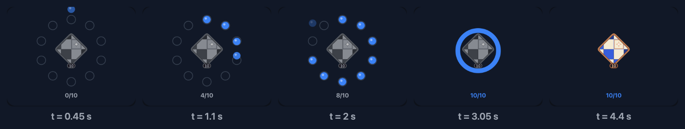
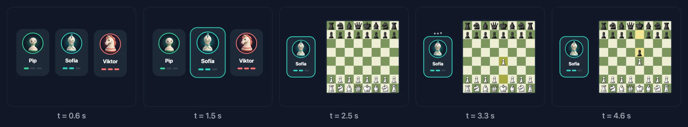

<!-- Borrador 2026-11-05 en la rama drafts/kit-y-animaciones. Enfoque: usos de la IA de los que no he oído hablar. Cotejado con design-iphone/assets/motion.js del kit y con MotionKit.swift y MotionScenes de la app. Las demos ejecutan el motion.js del kit (static/demos/motion-scene/assets). -->

Llevo un tiempo viendo cómo la gente hace motion graphics con IA. Desde que salió Opus 5.5, cada semana aparece alguien con un vídeo de producto, una intro animada o una explicación con tipografía en movimiento, y todo hecho describiendo lo que quiere a un agente que escribe el código.

Después de ver unos cuantos, me pregunté otra cosa: **¿hay alguna forma de hacer esto mismo y llevarlo a SwiftUI nativo?** No quiero un vídeo dentro de la app. Quiero una escena que se dibuje en el dispositivo, como una vista más.

Que la escena sea código y no un vídeo incrustado me da control sobre cosas que un vídeo no permite. Puedo cambiar la velocidad sin volver a exportar nada. La misma escena se pinta con los colores del modo claro o del oscuro, porque lee los colores de la app en ese momento. Y se puede adaptar al dispositivo: en el iPhone Duo no tiene sentido enseñar la misma animación con el móvil abierto que cerrado, y la escena del reloj, por ejemplo, enseña la bisagra de verdad cuando el Duo está en modo tabletop. Aquí lo puedes ver de las dos formas:



Hay otro caso que me parece todavía más interesante. Algunas personas activan en el sistema la opción **Reducir movimiento** (*Reduce Motion* en inglés), en Ajustes › Accesibilidad › Movimiento, porque las animaciones las marean o las distraen. Las apps pueden leer ese ajuste (en SwiftUI, con el valor de entorno `accessibilityReduceMotion`). Con un vídeo, lo único que puedes hacer es quitarlo. Con una escena en código, elijo un fotograma que ya cuente la historia y lo dejo como imagen fija, respetando la decisión de esa persona.

Se puede, y este artículo cuenta cómo lo hago en MindChess. El onboarding y la pantalla de Novedades tienen pequeñas escenas animadas. Todas nacieron en HTML con un agente de IA, y todas pasaron a SwiftUI **sin usar ni una animación de SwiftUI**: ni `withAnimation`, ni `matchedGeometryEffect`, ni transiciones.

Primero cuento la idea y cómo se pasa a SwiftUI, y luego la aplico a dos escenas reales que puedes tocar en el navegador: la de la insignia y la de los bots.

## La idea: una escena es una función del tiempo

La forma habitual de animar en SwiftUI es declarar estados y dejar que el sistema interpole entre ellos. Funciona muy bien para la interfaz, pero para una escena de cinco segundos con quince cosas moviéndose a destiempo se vuelve una cadena de `DispatchQueue.main.asyncAfter`, estados intermedios y animaciones que se pisan.

Los motion graphics que hace la gente con IA no funcionan así. Son una línea de tiempo: en el segundo 1,2 esto está aquí, en el 1,5 está allí. Así que copié esa idea. En las escenas de MindChess no hay estado. Hay una función:

```text
draw(t) → el fotograma en el segundo t
```

Todo lo que se ve se calcula a partir de `t`: dónde está cada pieza, su opacidad, su tamaño, qué jugada se ha hecho. Nada depende del fotograma anterior.

Eso da tres cosas gratis:

- **Tests de capturas deterministas** (los *snapshot tests*, que comparan una imagen de la vista con una guardada): pintar `draw(4.4)` da siempre la misma imagen.
- **Reducir movimiento:** en vez de animar, se pinta un único fotograma quieto que ya cuenta la historia.
- **Bucles sin costura:** si al final de la escena todo vuelve a opacidad cero, el segundo 0 y el último encajan.

Y una cuarta que es la que importa aquí: **una función pura se traduce de un lenguaje a otro.** Si el prototipo es una función de JavaScript sin estado, el port a Swift es otra función con las mismas líneas.

## Una caja fija y una gramática

Todas las escenas se dibujan en una caja lógica de **360 × 280** puntos, y luego se escalan al hueco que les dé la pantalla. Así las coordenadas del prototipo y las de Swift son las mismas, número a número.

Y todas siguen la misma gramática: **entrada → acción → resultado → reposo**. Algo aparece, pasa algo, se ve el resultado y la escena se queda quieta en un fotograma que lo resume. Ese fotograma de reposo es el segundo que cada escena declara como `stillTime`: es el que se pinta con Reducir movimiento y en los tests de capturas, así que tiene que contar la historia él solo.

Esta gramática también es lo que le pido al agente. No le digo «hazme una animación bonita»: le digo qué pasa en cada fase y en qué segundo.

## Curvas en forma cerrada

Para que `draw(t)` sea pura, el movimiento no puede salir de una simulación paso a paso. Todas las curvas son **fórmulas cerradas** que se evalúan en cualquier instante. Son cinco, y caben en una pantalla.

En JavaScript, en el prototipo:

```js
const S = (x, w = 14) => {          // muelle amortiguado de 0 a 1
  if (x <= 0) return 0;
  const z = 0.78, wd = w * Math.sqrt(1 - z * z), e = Math.exp(-z * w * x);
  return 1 - e * (Math.cos(wd * x) + ((z * w) / wd) * Math.sin(wd * x));
};
const clamp = (v, a = 0, b = 1) => Math.min(b, Math.max(a, v));
const smooth = (a, b, x) => { const u = clamp((x - a) / (b - a)); return u * u * (3 - 2 * u); };
const lerp = (a, b, k) => a + (b - a) * k;
const bump = (t, c, len = 0.14, w = 30) => S(t - c, w) - S(t - c - len, w);
```

Y en Swift, en la app, línea por línea:

```swift
public enum Motion {
    /// Damped spring from 0 to 1 starting at `x = 0` (damping 0.78, `w` rad/s); 0 before it starts.
    public static func spring(_ x: Double, _ w: Double = 14) -> Double {
        guard x > 0 else { return 0 }
        let z = 0.78, wd = w * (1 - z * z).squareRoot(), e = exp(-z * w * x)
        return 1 - e * (cos(wd * x) + (z * w / wd) * sin(wd * x))
    }

    public static func clamp(_ v: Double, _ a: Double = 0, _ b: Double = 1) -> Double { min(b, max(a, v)) }

    public static func smooth(_ a: Double, _ b: Double, _ x: Double) -> Double {
        let u = clamp((x - a) / (b - a))
        return u * u * (3 - 2 * u)
    }

    public static func lerp(_ a: Double, _ b: Double, _ k: Double) -> Double { a + (b - a) * k }

    /// A spring up at `c` and back down `len` seconds later.
    public static func bump(_ t: Double, _ c: Double, _ len: Double = 0.14, _ w: Double = 30) -> Double {
        spring(t - c, w) - spring(t - c - len, w)
    }
}
```

`spring` es la respuesta de un muelle con amortiguación 0,78: sube de 0 a 1, se pasa un poco y se asienta. El parámetro `w` decide lo rápido que lo hace. `smooth` va de 0 a 1 entre dos instantes, arrancando y frenando suave (es la curva que en gráficos se llama *smoothstep*), perfecta para fundidos. `bump` es un muelle que sube y baja: un «pop».

En las demos de los dos casos, más abajo, puedes cambiar la amortiguación y la frecuencia y ver cómo cambia la forma del muelle. El punto marca dónde está el muelle principal de la escena en cada instante.

## Prototipar en el navegador con IA

El prototipo vive en el kit de diseño de MindChess, en un archivo de escenas en JavaScript (`motion.js`). Cada escena es una función que recibe el contexto de un `<canvas>` y `t`. Escribirlas con un agente de IA funciona especialmente bien, por tres motivos:

1. **La descripción en lenguaje natural ya es casi el código.** «Diez monedas en un anillo de radio 88; cae una cada 0,2 s desde 64 pt más arriba con un muelle de frecuencia 16» se traduce casi literalmente.
2. **Se itera mirando el navegador.** Recargo, arrastro el tiempo hasta el momento que no me gusta y le digo al agente qué cambiar en ese segundo concreto.
3. **Los datos son reales.** Los colores salen de los tokens de la app, las piezas son las del juego y los avatares son los de los bots de verdad.

Y luego el mismo agente hace el port. Le paso la escena de JavaScript y el kit de Swift, y como las dos son funciones puras con las mismas curvas, el resultado sale casi a la primera.

## El port a SwiftUI

El port tiene tres piezas.

**Un protocolo para las escenas.** Cada escena dice cuánto dura, cuál es su fotograma quieto y cómo se dibuja:

```swift
public protocol MotionScene: Sendable {
    var duration: Double { get }
    var stillTime: Double { get }
    var box: CGSize { get }       // 360 × 280 por defecto
    var speed: Double { get }     // 1 por defecto
    func draw(_ canvas: inout MotionCanvas, t: Double)
}
```

**Un lienzo que se copia.** `MotionCanvas` envuelve el `GraphicsContext` de SwiftUI (el objeto con el que se dibuja dentro de un `Canvas`), la paleta del esquema de color y unos cuantos helpers (`circle`, `fill`, `text`, `image`). Es un tipo valor (un `struct`: al asignarlo se copia), y eso sustituye al `save()` y `restore()` del canvas de HTML, que guardan y recuperan el estado del dibujo: para cambiar la opacidad o la transformación de una parte, se copia, se cambia la copia y se tira.

```swift
var coin = c                       // copia: guarda el estado
coin.fade(M.clamp((t - ti) * 6) * (1 - melt))
coin.circle(CGPoint(x: p.x, y: y), 10.5, accent)
// al salir de este ámbito, `c` sigue como estaba
```

**Una vista que da tiempo a la escena.** Es un `Canvas` (la vista de SwiftUI para dibujar a mano, como un `<canvas>` de HTML) dentro de un `TimelineView` (una vista que se vuelve a pintar en cada fotograma y te dice la hora). Escala la caja de 360 × 280 al hueco disponible y llama a `draw` con el `t` que toque:

```swift
TimelineView(.animation(minimumInterval: 1 / 60, paused: !isLive || !isOnScreen)) { timeline in
    Canvas { context, size in
        let time = reduceMotion || isResting
            ? scene.stillTime
            : liveTime(timeline.date.timeIntervalSince(start))
        draw(in: context, size: size, t: time)
    }
}
```

Con eso, veamos dos escenas reales.

## Caso 1: diez monedas que forjan una insignia

La primera es del onboarding: cada partida que juegas es una moneda, y diez monedas forjan tu primera insignia. Siguiendo la gramática:

| Fase | Tiempo | Qué pasa |
|---|---|---|
| Entrada | 0–0,25 s | Aparece el anillo de diez huecos |
| Acción | 0,35–2,15 s | Cae una moneda cada 0,2 s y el contador sube |
| Resultado | 2,75–4,0 s | El anillo se funde, la insignia gira y se gana, salen chispas |
| Reposo | 4,4 s | El fotograma quieto: la insignia y «10/10» |



Esta es la escena real, ejecutando el mismo código JavaScript del prototipo. Puedes pararla y moverte por el tiempo:



Arrastra `t` y verás que puedes ir a cualquier instante, hacia delante o hacia atrás. Esa es toda la idea.

Así es en el prototipo (reducida):

```js
M.define('coins', { dur: 6, still: 4.4, draw(g, t, e) {
  const { th } = e, cx = 180, cy = 124, R = 88, FORGE = 2.75;
  g.globalAlpha = smooth(0, 0.25, t) * (1 - smooth(5.4, 5.9, t));  // entrada y salida
  const melt = smooth(FORGE, FORGE + 0.3, t);
  for (let i = 0; i < 10; i++) {
    const a = -Math.PI / 2 + (i * Math.PI * 2) / 10, x = cx + R * Math.cos(a), y = cy + R * Math.sin(a);
    const ti = 0.35 + i * 0.2, k = S(t - ti, 16);
    if (t > ti) {
      g.save(); g.globalAlpha *= clamp((t - ti) * 6) * (1 - melt);
      const yy = lerp(y - 64, y, k);                                 // cae desde 64 pt más arriba
      circle(g, x, yy, 10.5, C.accent); g.restore();
    }
  }
  // …el anillo que se funde, la insignia que gira, las chispas y el contador
} });
```

Y en Swift, con las mismas curvas y la misma caja, se lee igual:

```swift
struct CoinsScene: MotionScene {
    var duration: Double { 6 }
    var stillTime: Double { 4.4 }

    func draw(_ c: inout MotionCanvas, t: Double) {
        let cx = 180.0, cy = 124.0, r = 88.0, forge = 2.75
        c.fade(M.smooth(0, 0.25, t) * (1 - M.smooth(5.4, 5.9, t)))
        let melt = M.smooth(forge, forge + 0.3, t)
        for i in 0..<10 {
            let a = -Double.pi / 2 + Double(i) * 2 * .pi / 10
            let p = CGPoint(x: cx + r * cos(a), y: cy + r * sin(a))
            let ti = 0.35 + Double(i) * 0.2, k = M.spring(t - ti, 16)
            guard t > ti else { continue }
            var coin = c
            coin.fade(M.clamp((t - ti) * 6) * (1 - melt))
            let y = M.lerp(p.y - 64, p.y, k)
            coin.circle(CGPoint(x: p.x, y: y), 10.5, accent)
        }
        // …el anillo que se funde, la insignia que gira, las chispas y el contador
    }
}
```

## Caso 2: elige tu rival y juega la primera jugada

La segunda es de la 1.4, para presentar los bots. Tres rivales, uno por nivel. Se elige a Sofía, se sienta junto al tablero y responde a 1.e4 con 1…e5. Aquí ya hay un tablero de verdad, con piezas que vuelan de una casilla a otra:

| Fase | Tiempo | Qué pasa |
|---|---|---|
| Entrada | 0–0,6 s | Aparecen las tres tarjetas, una detrás de otra |
| Acción | 1,35–2,4 s | Sofía se ilumina, los otros dos se van, ella va a su sitio y aparece el tablero |
| Resultado | 2,75–3,9 s | 1.e4; Sofía piensa (los tres puntos) y responde 1…e5 |
| Reposo | 4,6 s | El fotograma quieto: Sofía junto al tablero con la última jugada marcada |



Y aquí, funcionando, con el mismo control del tiempo:



Lo interesante de esta escena es cómo se reparte el trabajo entre funciones. El tablero es una función aparte, `playBoard`, que recibe una posición y una lista de jugadas con el segundo en que se juega cada una. Cada jugada es un muelle de la casilla de salida a la de llegada, y la última se marca en amarillo, como en la app. La escena solo dice qué jugadas y cuándo:

```swift
struct BotsScene: MotionScene {
    let board: BoardTheme
    let pieces: PieceTheme
    let avatarStyle: BotAvatarStyle
    var duration: Double { 6 }
    var stillTime: Double { 4.6 }
    var speed: Double { 1.2 }

    func draw(_ c: inout MotionCanvas, t: Double) {
        let select = 1.35, move = 2.0
        c.fade(M.smooth(0, 0.2, t) * (1 - M.smooth(5.45, 5.95, t)))
        let leave = M.smooth(select + 0.3, select + 0.75, t), m = M.spring(t - move, 9)
        // …Pip y Viktor entran y se van con `leave`
        let bk = M.spring(t - move - 0.15, 12)
        if bk > 0 {
            var table = c
            table.fade(bk * 1.3)
            table.context.translateBy(x: 0, y: 14 * (1 - bk))
            playBoard(table, t: t, origin: CGPoint(x: 132, y: 40), side: 25, fen: startFEN,
                      moves: [("e2", "e4", 2.75), ("e7", "e5", 3.65)], board: board, pieces: pieces)
        }
        // …y la tarjeta de Sofía va de 180 a 62 con el muelle `m`
    }
}
```

Fíjate en las tres propiedades de arriba: `board`, `pieces` y `avatarStyle`. En el prototipo el tablero es verde y las piezas son las de serie. En la app, la escena usa **el tema de tablero, las piezas y el estilo de avatar que el usuario ha elegido en Ajustes**. Eso es justo lo que un vídeo no puede hacer.

Y `speed: 1.2`. La escena se diseñó en seis segundos, pero en la app conviene que dé la vuelta en cinco. En vez de rehacer los tiempos, la escena declara una velocidad y el tiempo real se multiplica por ella.

## Los detalles que solo salen en la app

Al reproducir las escenas en la app salieron cosas que no se ven en el prototipo:

- **Se reproduce dos veces y se queda quieta.** Una animación en bucle infinito en un onboarding distrae y gasta batería. Después de dos vueltas, la escena se para en su `stillTime`, que está dentro de la segunda vuelta, así que no hay salto. A partir de ahí el `TimelineView` está en pausa y no se redibuja nada.
- **En pausa fuera de pantalla** y oculta para VoiceOver, porque es decorativa: el texto de la página ya cuenta lo mismo.

## Los tests

Como el tiempo es un parámetro, un valor de entorno permite fijarlo:

```swift
public enum MotionPlayback: Equatable, Sendable {
    case live
    case still
    case time(Double)
}
```

Los snapshots del onboarding y de Novedades pintan cada escena en su fotograma quieto, en claro y oscuro, en el iPhone y en cada postura del Duo. Si alguien cambia una curva y la insignia ya no queda centrada en el segundo 4,4, el test falla.

## Lo que me llevo

- **La IA no solo sirve para hacer vídeos con motion graphics.** Si le pides la escena como una función del tiempo, el resultado se puede llevar a código nativo.
- **Una función del tiempo es más fácil de razonar que una cadena de animaciones.** Y se puede ir a cualquier instante para depurarla.
- **Las fórmulas cerradas viajan bien entre lenguajes.** Las curvas de JavaScript y las de Swift son las mismas líneas con otra sintaxis, y el port lo hace el mismo agente.
- **Prototipar en el navegador con un agente es muy rápido** cuando puedes señalar un segundo concreto y decir qué falla.
- **Accesibilidad y tests salen solos** si el fotograma quieto cuenta la historia.


